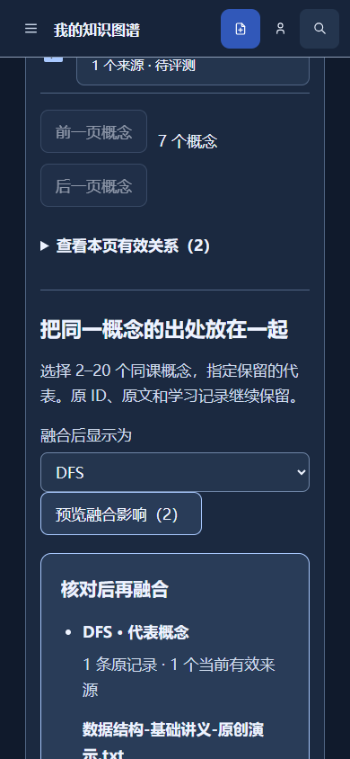

# Knowledge Graph 2.0 B级交付

日期：2026-10-22。范围：课程内多资料提取、逐项审核、融合与证据管理。用户已明确“B级通过”，当前为已验收本地成果；未推送、未部署、未开始C级实现。阶段前基线61d5bce，独立分支codex/knowledge-graph-2-audit。

## 1. 本阶段完成内容

本地B级工程闭环已完成；独立审阅提出的重要问题已一次修复并通过回归，用户于2026-10-22明确“B级通过”。默认前后端开关均关闭。未宣称Knowledge Graph 2.0全部完成，学习联动和大画布仍在后续等级。

- 同一身份私有SQLite中的课程、章节、已有资料挂接；不同课程各自保留概念。同名及带符号术语不自动融合。
- 每组1–10份，逐份本地或模型提取，最多20000字符、80节点/120关系。候选、状态、截断说明与审核决策持久化；失败不写成成功图谱。
- 每项接受／拒绝／修订，原文引用逐项校验；无效项不可确认，复杂语义需人工核对。保存后预览一次确认，事务失败全部回滚。
- 2–20个同课概念预览融合；原ID和多来源引文保留。前置依赖环拒绝，自身关系明确不在视图显示。指定操作撤销/恢复受后续依赖与版本约束，不撤销后来的编辑。
- 移出课程仅取消引用并保留学习历史；彻底删除沿用旧隐私合同，预览包含新增图谱影响。无有效来源的概念保留，关系不支持当前推荐。
- 个人备份覆盖新表，兼容schema30；恢复不重放AI，轮换执行epoch并清除旧预览，阻止恢复前迟到请求覆盖新状态。
- 新HTTP接口每次使用当前真实租户存储；浏览器密钥只在明确授权的完整extract请求里临时可用，不写入数据库或日志。
- B功能面板复用已有资料入口、原无衬线及四主题，大字、SVG、逐来源进度、分页与错误恢复。C再调整大工作台布局。

## 2. 需求覆盖

B1资料与课程组织、B2结构化提取与引文、B3同课融合与撤销、B4逐项审核编辑、B5持久化/权限/来源与隐私均已接入。真实模型仅做两份原创短资料的小样本验证；不代表真实学生学习效果、模型总体准确率或全部文档格式质量。

旧图谱及其knowledge_key、题集、作答、错题、计划保持原义；B不自动复制旧批次，不另造掌握度。新概念显示待评测，后续D再做显式映射与学习证据联动。

## 3. 修改范围与数据库

业务迁移追加31，共8张kg_表；原1–30迁移不改。符号出现身份由确定性evidence_id承载，legacy_node_id仅作无歧义旧键提示；原旧图谱键不改。主实现为`filemate/course_graph/`与`filemate/execution/course_graph_schema.py`。接线涉及storage删除预览、personal_backup恢复、server路由、临时模型凭据白名单、Vue审核状态/三个组件/API/类型、环境示例与门禁清单。

API逐项合同见[API_SPEC](../filemate/docs/API_SPEC.md#2026-10-22-课程知识图谱-b-候选schema31默认关闭)，完整任务见[九项计划](superpowers/plans/2026-10-22-course-knowledge-graph-foundation.md)。新增验收准备脚本`scripts/acceptance/course_graph_fixture.py`仅接受新绝对目录，生成3份原创TXT与合成账号；密码由FILEMATE_AUDIT_PASSWORD临时提供，不输出密码、恢复码或会话。运行方式：`uv run python -m scripts.acceptance.course_graph_fixture --data-root <新绝对目录>`；此目录为专用环境的data根，FILEMATE_DB_PATH指向返回的database_path。

## 4. 实际运行演示

使用本轮回环8096/5194专用数据根；浏览器先匿名操作，再注册合成账户继承空间。全部是原创工程资料，没有真人学生数据。

1. 导入基础讲义、补充笔记；建立数据结构课程并选择两份资料。
2. 本地逐来源提取，拒绝HTML测试候选、把队列显示名称修订为“队列（FIFO）”；保存、预览、确认入图。
3. 选择两份“栈”融合，打开两份独立原文引用；历史中撤销并恢复指定融合，刷新后仍存在。
4. Python程序设计课程导入另一份“栈”资料。HTTP与SQL交叉核对两课概念ID不重叠，Python仅有1个来源，数据结构融合栈有2个来源。
5. 延迟第一份extract并取消，后续未继续请求；迟到请求409 draft_cancelled。断网后旧概念仍显示，恢复网络可读取；模拟503显示错误并恢复。原文SVG按文本显示，没有脚本执行。
6. 真实数据结构账户中准备1条作答、1道错题、1份计划。先导出个人ZIP，再从界面移出来源，五张历史表逐行一致；HTTP预览恢复后，JSON字段按原恢复合同重新序列化，语义与学习记录一致，双来源恢复，外键错误0。
7. 验证1920×1080、1366×768、1024×768、1180×820、390×844，无水平溢出，操作按钮最小48px。截图关闭动画以免截取侧栏过渡中间帧。

截图和脱敏JSON见[证据目录](audits/knowledge-graph-2-b-2026-10-22/)。备份、数据库、浏览器会话及原始日志仅留_working，不提交。

## 5. 实际测试结果

- 默认全量：`powershell -NoProfile -ExecutionPolicy Bypass -File scripts/verify.ps1 -IsolateFrontend`，退出0。Ruff通过；后端1389通过、22跳过、5按not e2e取消选择、3已有警告；前端149通过、0失败；类型/构建/首屏预算通过。此结果含B新增77项后端用例；不是沿用A级数量。
- 22跳过来自Linux专属分支、未提供真实附件夹具、可选OCR、符号链接权限；3警告为Starlette/httpx、PyPDF2和请求cookie旧接口。Windows结果不替代Linux发布门禁。
- 定向RED→GREEN覆盖：迁移隔离、逐项引用、模型认领/取消/配额、原子确认、融合循环/后续依赖、删除/备份迟到竞态、HTTP授权与幂等；前端切换迟到、未保存选择、重试键、取消和已撤销候选。
- 迁移30→31副本和重复初始化通过，旧Source/批次/历史逐行保留、integrity=ok/FK=0；schema30及31个人备份恢复通过。未在生产库试验迁移。
- 真实DeepSeek/deepseek-v4-flash：两次HTTP200，各4节点＋1关系；全部10项引文校验有效，人工核对原文明示关系成立。分别1733/1597ms（含HTTP），供应商记录真实token410/409、合计819；没有把预算单位当成费用。见[模型摘要](audits/knowledge-graph-2-b-2026-10-22/real-model-summary.json)。前两次模型结果未自动确认；最终再以第三份原创符号资料调用并明确审核确认C/C#/C++/A-B/AB，5个独立概念保存，第三次450tokens，3次合计1269tokens。费用金额未知，见[最终符号回归](audits/knowledge-graph-2-b-2026-10-22/final-symbol-model.json)。
- 主题验收发现午夜模式主按钮错误使用浅色accent＋白字，对比度1.68。改用现有action-fill，浏览器RED→GREEN；四主题主操作对比度7.31/7.31/8.21/6.51。最终修复后的默认门禁已重新执行，前端149项及类型/构建/预算通过。
- 原有24个用户修改测试文件按预留SHA256全部一致，未暂存。

## 6. 当前限制

- C大画布、万节点布局/邻域查询、跨课联系、D真实学习联动、E受控Agent与真人实验未实现；本级只按B验收。
- 原文是当前Source版本，引用失效时不补造历史原文。模型超过20000字符的后文未处理；复杂关系需人工审核，本地规则覆盖有限。
- B图投影的关系及同名候选查询仍扫描课程内记录；10000节点/30000前置关系以上拒绝循环检查。未声称万节点性能已通过。完整屏幕阅读器、实体设备和其他供应商真实调用也未验证。
- 各模型来源只有一次45秒调用；失败需显式新命令重试，取消不能撤回供应商已消耗费用。供应商质量、网络和真实费用仍有外部依赖。
- 新旧图谱分开；关闭开关保留数据。回退需使用兼容schema31代码关闭新模块，旧schema30二进制不可直接打开31库；不得用赛前旧备份覆盖新学习数据。
- 生产迁移、Linux重验及发布未做；本次不更换线上稳定版本。

## 7. 后续三个重点

1. B通过后，优先C课程目录＋画布＋证据栏，保留本轮确认事务与错误恢复。
2. 数据结构增加长资料、PDF/课件和复杂关系样本，扩充人工标注后再评估提取质量。
3. 冻结前仍以稳定站为基准，发布另行执行Linux门禁、生产副本迁移与恢复演练。

## 8. 用户验收与下一阶段

2026-10-22用户明确“B级通过”。沿用A级已选学术工作台，不重复确认整体布局。C尚未开始实现，用户随后确认三个交互决定：

1. 关系图优先，之后记住课程上次视图；提取审核按需打开。
2. 章节分组、逐步展开、关联高亮，搜索能定位未展开节点。
3. 手机课程／知识点列表与完整详情为主，图谱按需打开。

详细[C级工作台设计](superpowers/specs/2026-10-22-knowledge-workspace-c-design.md)随后已确认，[八项实现计划](superpowers/plans/2026-10-22-knowledge-workspace-c.md)待用户审阅。

C仍按原始要求细化关系图、大纲、证据视图、来源跳转与响应式验收；万节点性能未经验证，不因视觉重构自动标记通过。本级问题及C设计已确认，八项实现计划审阅后才开始实施；时间不足时保留稳定站，不把局部C成果称为完整验收。

独立审阅报告及全部裁定见[审阅与修复记录](audits/knowledge-graph-2-b-2026-10-22/independent-review.md)：原7项Important及升级的1项500问题均有RED→GREEN回归；未再次派审阅者，最终全量退出0。没有遗留Minor。用户B级验收已通过；生产发布与C级实现方案仍待确认，本报告不是上线回执。
