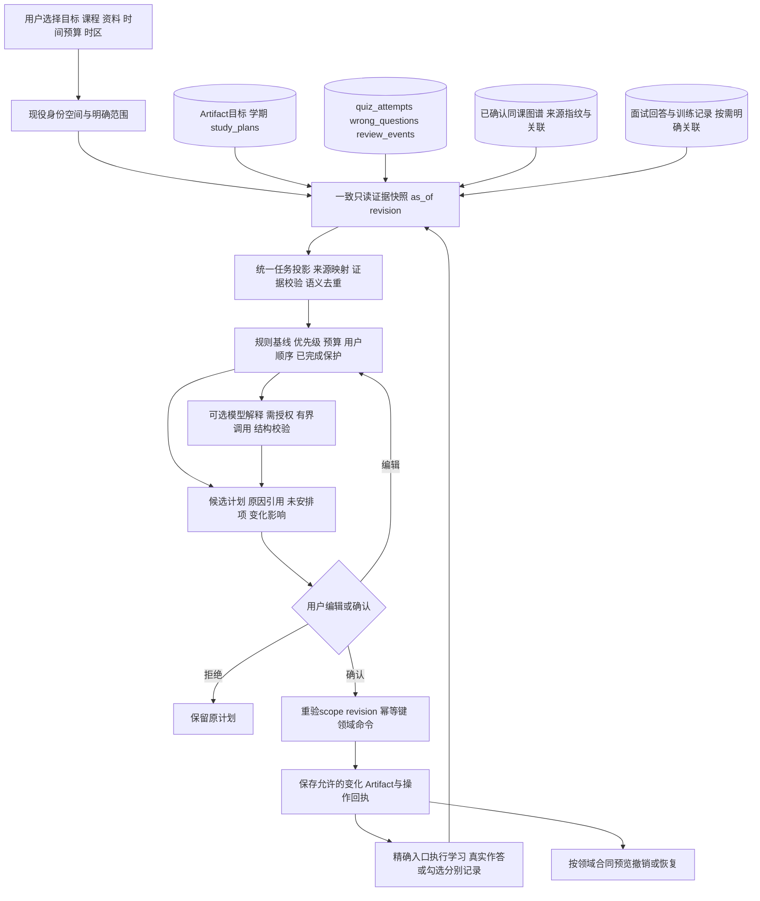

# Learning Orchestrator 2.0 · A级现状审计与总体方案草案

审计日期：2026-10-31。状态：**A级草案，等待用户审阅；B—E未启动。**

本文件根据当前工作树的源码、合同、现有测试内容及历史验收附件形成，不把历史研发说明当作本轮运行成功证据。第四专项提示要求“错题复盘2.0完成并通过正式验收之后启动”；本轮与第三专项收尾并行制作的是供确认的A级材料，不据此宣布第三专项正式验收或第四专项实施获准。

工作树：`C:/Users/胡希/.codex/worktrees/release-alpha3/FileMate-Project`。分支名称由主执行者提供为`codex/wrongbook-2-audit`，本审计未操作Git。主执行者继续第三专项实现，工作树不是冻结构建；行号为本轮读取时的定位，后续须按符号复核。本审计只新增本文件，不改源码、迁移、24份用户既有测试、真实资料或数据库，不调用外部模型，不访问生产。本轮没有执行测试、浏览器验收、SQLite版本探针或性能测试；下文“已有测试”仅表示仓内存在这些断言。

## 1. 总体判断

现役系统已经有目标Artifact、持久学习计划、今日时间预算与手动顺序、学期任务、真实作答和复习事件、图谱路径及面试回答证据。最缺少的不是另一个任务表，而是**在明确目标范围内，统一读取证据和既有任务、解释优先级、生成可确认变化的决策边界**。

建议采用方案二：在现有FastAPI进程内增加独立的学习决策服务层，先只读聚合和规则调度；确认写入时委托既有领域命令。复用现役SQLite、学习空间、`study_plans`、Artifact及各模块事件，不增设独立服务器、第二套身份系统或模型供应商。此为推荐，尚未获用户确认。

最高风险集中于：同名任务身份不同；一个真实错题在计划与到期队列中重复出现；旧目标重规划立即写入且保护不完整；服务器本地日期与上海自然日混用；跨课程或失效资料误入证据；仅有勾选记录却被解释为掌握；历史兼容声明替代生产验证。

## 2. 阅读范围与事实优先级

已核读`AGENTS.md`、`README.md`、`PRODUCT.md`、`DESIGN.md`、`design-system/filemate/MASTER.md`、`filemate/docs/API_SPEC.md`及`docs/AGENT_DEVELOPMENT_EXECUTION_PLAN.md`相关段落，并检查提示指定的全部study模块、五个页面、API客户端、路由和迁移列表。图谱与面试、前端分为两个独立只读审计域，合并时重新核对关键接线。

事实优先级为：当前函数及返回值 → 当前迁移和路由 → 当前测试断言 → 可定位的历史运行附件 → 历史概述。例：`get_learning_analytics()`中间仍计算旧计划计数，但末尾用`evidence_profile`覆盖最终计划天数与完成率，不能仅凭中间SQL认定archived计划仍影响该返回值（`filemate/execution/storage.py:3322`、`:3375`、`:3386`）。

产品边界遵守`PRODUCT.md:20`、`:40`、`:56`：可追溯学习资产、本地可运行、无数据待评测；没有真实学生效果实验。视觉以`DESIGN.md:34`及`MASTER.md`2026-10-18章节为当前规范，不采用下方冲突的历史自然绿、艺术字、旧图标库或只支持浅色的要求。

## 3. 前三个专项：已有证据与不能外推的结论

| 专项 | 当前代码核验 | 仓内既有完成证据 | 限制与本次判断 |
|---|---|---|---|
| 模拟面试2.0 | 回答版本、实战、六维评价迁移27–30在列表中；固定题错题讲解可经Agent引用关联目标，完成后核对证据并同步指定任务（`storage.py:631`；`server.py:4227`、`:4312`、`:4720`） | [2026-10-21发布回执](INTERVIEW_2_0_RELEASE_2026-10-21.md)第15行记载Linux1330后端、140前端及公网11组；回执`:25`记录27→30迁移与旧表指纹 | 历史状态为已上线、CONDITIONAL PASS。新独立录音录像关闭，设备、评分校准、真实学生研究和长期容量未完成（回执`:55`）。本轮未复跑，不证明所有场景都能通用关联目标 |
| 知识图谱2.0 | confirmed同课关系和有效来源参与路径；确认新增现役study_plan及概念关联，不建独立任务账本（`course_graph/learning_paths.py:82`、`:260`）；作答按题目版本关联（`learning_evidence.py:41`、`:110`） | [2026-10-24/25发布记录](KNOWLEDGE_GRAPH_2_RELEASE_2026-10-24.md)第17行记载Windows1544、Linux1562后端和213前端；[CI附件](audits/knowledge-graph-2-de-2026-10-23/ci-final.json)存在；发布记录`:27`记载公网11组及备份恢复 | 历史状态为已上线、CONDITIONAL PASS。生产SQLite3.26曾因`AS MATERIALIZED`真实故障后修复；万节点和并发门禁未全部通过，完整键盘、人工gold、真实研究保留（记录`:19`、`:25`、`:51`、`:54`）。不能将其性能预算直接叠加到今日页 |
| 错题复盘2.0 | schema35–36、可信作答、review_events、状态/排期、分析和增量计划存在（`storage.py:640`；`wrongbook/schema.py:3`、`:49`；`learning_commands.py:209`） | [E交付](WRONGBOOK_2_0_E_DELIVERY.md)第73行及[验证JSON](audits/wrongbook-2-e-2026-10-29/verification.json)记载1720后端、278前端，10场景、浏览器/恢复；[10-30容量补充](WRONGBOOK_P2_CAPACITY_2026-10-30.md)及[附件](audits/wrongbook-p2-2026-10-30/verification.json)记载1820后端、281前端、17个HTTP容量场景，本地P2-INC-B-01 PASS | 历史E与增量B为本地CONDITIONAL PASS，未部署。容量补充取代旧B对应分布的本地P2结论，未替代生产Linux、完整旧运行时、无JSON1万题容量或真实效果验证。10-30记录的C未挂载只描述冻结版本；本轮主执行者正在接入可见交互，不能把实施中字节称为已验收 |

以上数字均为**历史记录，本审计未执行**，不将不同批次通过数相加。第三专项本轮最新门禁、浏览器和用户验收由主执行者在专项收尾回执中独立给出；本文件不代其关闭剩余条件。

当前源码最高迁移声明为业务36（`filemate/execution/storage.py:607`–`:641`），不是本轮读取实际数据库得出的schema值。当前生产运行版本、解释器、SQLite编译能力、schema和应用兼容性均**未知**。

## 4. A1 实际实现矩阵

以下路径省略公共前缀`filemate/`时，以表中完整目录说明为准；`server.py`位于仓库根。风险是第四专项集成修改风险，不代表本轮已复现运行故障。

| 功能 | 当前代码位置 | 真实状态与可复用能力 | 缺口 / 建议 | 风险 |
|---|---|---|---|---|
| 创建及持久目标 | `server.py:2851`、`:3148`、`:3197`；`web/src/views/GoalPlanner.vue:188` | 创建时直接生成并保存reverse_goal_plan Artifact；含类型、日期、可选分数和单个source_id；可保存多份并选择历史 | 缺候选→确认分离；多份目标并存不等于跨目标预算/冲突管理；先定义目标范围和当前目标选择 | 高 |
| 目标更新 / 重规划 | `server.py:3231`、`:3263`、`:3328`；`study/goal_planner.py:197` | 可切换任务完成；重规划沿用原目标配置并替换任务；普通同id完成可继承，口头任务额外绑定证据 | 未见专用名称/截止/分数编辑合同；replan立即写入，无变化预览/撤销或乐观修订；不得等同手动排序 | 高 |
| 目标反推及缺口 | `study/goal_planner.py:53`、`:75`、`:106`、`:131` | 纯规则任务与理由；真实计数、待评测和口头错因引用可复用 | 模板10次基线/70%执行率只是工程规则；不能换算掌握。pending_wrong不是due_count；面试参考分不能决定课程能力 | 高 |
| 学期课程配置 | `study/semester.py:18`、`:29`、`:110`；`server.py:3582` | 单个personal-semester-v1 Artifact，1–20课程、日期/资料校验、预览确认、修订、旧版本历史 | 学期course_id为用户配置标识，未见对kg_courses的正式映射；替换会把当前任务从未完成开始，旧进度仅在history，不能直接用于保护完成的动态调整 | 高 |
| 学期任务完成 / 恢复 | `study/semester.py:146` | completed布尔、completed_at及revision持久；过期修订拒绝；同状态不重复更新 | 与study_plans不是同一实体；不直接进入今日队列。恢复为false会移除当前completed_at，历史审计不是完整学习事件模型 | 中 |
| 课程/资料学习计划 | `execution/storage.py:259`、`:2688`、`:2806`；`server.py:2894` | study_plans关联study_plan Artifact；同artifact不重复建计划；零起始completed_days，完成/恢复维护active/completed，archived禁止更新 | 用户正文/逐项排序编辑未形成现役通用合同；天级勾选，无逐任务完成时间、真实用时和答对证据；进程内锁不等于跨实例合并 | 高 |
| 今日学习队列 | `server.py:3893`–`:3992`；`study/daily_coach.py:50` | 读取最近20个active计划，各取一个最早未完成日；到期错题最多50个候选；预算内最多8项；不写任务 | 不直接读取目标任务、学期任务、面试；未展示被延期的具体项目；可能预排未来学习日；20/50/8为投影上限，须显示覆盖范围 | 高 |
| 今日时间和手动顺序 | `server.py:2846`、`:3996`；`execution/storage.py:476`、`:2765`；`study/daily_coach.py:58` | 按study_date保存10–240分钟和最多50个唯一item_id；排序先尊重用户顺序，再score和稳定id；默认60分钟 | 不支持0分钟、单任务时长编辑、固定锁或跨日继承；同日多标签页为后写覆盖。修改后立即重算，重大变化需确认边界 | 中 |
| 具体学习入口 | `web/src/views/Today.vue:31`、`:35`；`GoalPlanner.vue:264`；`StudyPlan.vue:262` | 今日错题可内嵌真实作答并进入具体复盘；计划页可按plan ID恢复；目标资料/口述带source或goal上下文 | 今日计划项虽收到具体route，却只渲染“完成任务”而无计划详情链接；通用目标任务多去泛入口。C须逐来源补齐精确入口，无法定位时说明替代位置 | 中 |
| 到期错题与真实复习 | `wrongbook/repository.py:245`、`:256`；`wrongbook/schema.py:49`；`server.py:3947` | 到期按时刻、全库due_count与候选数分开；wrong:id路由精确；真实提交经同一领域命令保存 | 今日旧guidance与增量B推荐不是同一规则入口；不能复制排期状态或将计划勾选写成一次复习 | 高 |
| 图谱学习路径 | `course_graph/learning_paths.py:43`、`:82`、`:142`、`:173`、`:260` | 同课、有效来源、confirmed依赖；环拒绝；预览确认后新增study_plans，kg_course_plan_links关联概念/日；幂等 | 统一队列应读已有计划并展开关联，不能再导入一遍图谱任务；概念复习与指定错题是否同一行动须语义判断 | 高 |
| 图谱学习证据 / 恢复 | `course_graph/learning_evidence.py:41`、`:110`、`:148`；`course_graph/learning_commands.py:15`、`:67` | 真实题版本/作答/错题引用；完成日仅进度；撤销归档、恢复保留completed_days，用户改正文则冲突 | 不同领域撤销政策不可混用；万节点投影不能每次今日刷新完整重算 | 高 |
| 错题增量学习计划 | `wrongbook/learning_commands.py:116`、`:136`、`:178`、`:209`、`:247` | 本题真实上下文与目标校验；候选可编辑；确认新增study_plans和Artifact，保存review_learning依据；相同token重试返回原回执 | 新token可另建计划，未见跨模块语义去重。撤销只允许未完成未改动新增计划，不能照搬图谱归档政策 | 高 |
| 口头训练 / 面试关联 | `server.py:4227`、`:4312`、`:4751`；`interview_runtime.py:196` | 固定题口述任务可绑定goal/source/wrong/evidence，整场完成同步该任务；面试回答版本独立保存 | 通用目标、连续实战尚无同等接线；quiz attempt_id与interview_answer_attempts不能混为一类；不以分数写掌握 | 高 |
| 成长画像与报告 | `study/evidence_profile.py:71`、`:147`；`execution/storage.py:3375`；`portfolio/growth.py:37`、`:114`、`:144` | 画像只读、异常/回退排除、样本与时间/原入口；报告用一致快照并持久化Artifact，固定上海窗口；无记录待评测 | profile旧计划时间仅为updated_at，不能作完成事件；报告为历史快照而非实时证据；不能把全空间画像直接当某课程快照 | 高 |
| 权限 / 空间 / 迁移 | `server.py:238`、`:608`；`execution/storage.py:744`、`:778`、`:798` | 已有账号/游客空间、每身份库、ContextVar及只读事务、追加迁移和确认动作框架 | 复用，禁止新身份系统；所有适配器使用请求所属库；B前核对完整运行时和SQLite能力，不能凭声明通过 | 高 |

### 同名而身份不同的“任务”

| 现役身份 | 状态真源 | 当前入口 / 写入 | 不应做的映射 |
|---|---|---|---|
| 目标任务：`goal_id + tasks[].task_id`，如baseline-quiz | reverse_goal_plan Artifact.content | `/goals/{id}/tasks/{task_id}` | 语义模板id不全局唯一；勾选不等于真实作答 |
| 学习日：`plan_id + day_index` | study_plans.completed_days/status | `/study-plans/{id}/days/{index}`；今日item_id=`plan:{id}:{index}` | 学习日内可有多项，不能假装每一项有独立完成时间 |
| 学期任务：`personal-semester-v1 + revision + task_id` | semester Artifact.content.tasks | `/api/semester/tasks/{id}` | `{course}-week-N`不是kg概念id；更版后同名不保证同一任务 |
| 到期复习：wrong_id及其当前复习周期 | wrong_questions + quiz_attempts + review_events | `/wrongbook?focus=…`及错题领域命令 | 完成旧周期不永久完成该错题；新周期不能重置旧事件 |
| 图谱路径任务：计划学习日 + 概念关联 | study_plans + kg_course_plan_links | 图谱确认生成后走现役计划 | 不是需再复制到新表的一套待办 |
| 错题增量任务：计划学习日 + review_learning依据 | study_plans + Artifact + review_events | 学习建议确认生成后走现役计划 | 与到期队列同题不必然同动作；须区分阅读、复练、口述 |
| 面试训练及回答版本 | interview_sessions、interview_answer_attempts及关联事件 | `/interview?interview=…`；Agent context_refs可含目标 | interview attempt_id与quiz attempt_id没有共同外键语义 |

## 5. A2 数据一致性九问

### 1）今日任务来自哪些真实表？

现役`GET /review/today`来自study_plans（active、最近20个，每计划只取下一未完成日）、wrong_questions的到期候选，以及daily_coach_preferences；wrong详情会核对当前题集。它不新建任务，也不直接把reverse_goal_plan、semester Artifact或面试会话合并入队列（`server.py:3898`、`:3901`、`:3947`；`storage.py:2757`；`wrongbook/repository.py:245`）。未来统一层需明确新增的是读取适配，不再写一份待办。

### 2）学习计划完成状态如何保存？

study_plans.completed_days为零起始索引JSON，集合add/discard后维护status；学习日没有独立completed_at（`storage.py:2806`）。目标任务是Artifact内status，学期任务另有completed_at及revision（`server.py:3249`；`semester.py:157`）。可以反复设同状态，但三类记录不能互相代指。成长报告已明确旧计划仅当前完成快照，不能把updated_at当期间内真实完成时间（`growth.py:114`）。

### 3）图谱学习路径是否产生独立任务？

候选路径只是只读建议；确认会新增现役study_plan Artifact和study_plans，再写kg_course_plan_links和来源依赖（`learning_paths.py:173`、`:265`–`:273`）。今日已经能读到这些计划，因此统一层不能再把路径任务重新创建一遍。已有断言覆盖“手工旧计划不变、同确认一份、今日接线及完成不作掌握证据”（`tests/course_graph/test_learning_paths.py:106`、`:123`、`:156`），本轮未执行。

### 4）错题复习与今日是否可能重复记录一次任务？

今日中的wrong项由GET只读投影，不因展示单独记一次作答；今日内嵌ReviewEntry或错题页实际提交领域命令才写真实作答/事件（`Today.vue:31`）。重复风险在展示和日程语义：错题增量计划的training_actions可再指向同wrong，同时今日直接列出到期wrong；图谱review也可能引用它（`server.py:3933`、`:3955`；`wrongbook/learning_commands.py:151`–`:162`；`learning_paths.py:142`）。现役候选身份plan:…和wrong:…不同，`select_daily_queue()`不做跨来源语义去重。确认token幂等只能防同操作重试，不能宣称解决多模块同题重复。

### 5）面试完成记录能否关联用户目标？

可以，但当前范围窄：`goal_id`必须指向同资料、同错题且有效的explain-wrong-aloud；关联保存在Agent context_refs，整场完成后核对证据标记该目标任务（`server.py:4227`、`:4312`、`:4751`）。不能推断所有面试均有目标外键。连续实战PrepareRuntime/DraftContent没有上述通用goal/focus字段（`interview_config.py:76`；`interview_runtime.py:196`）。B应先只读关联，通用训练写入另做明确确认。

### 6）资料删除后，原目标建议是否仍有效？

不是一律保留有效，也不是一律仅标失效。source_id绑定的目标本身是Artifact，sources→artifacts外键为ON DELETE CASCADE（`storage.py:125`）；删除预览包含Artifact、计划、作答等影响（`:1376`、`:1454`）。资料绑定目标可被整体级联删除；学期course.source_id是JSON，不是该外键；无来源全局目标仍存在。口述任务读取时还复核题目、最新失败作答、错因、chunk与source revision（`server.py:2940`、`:2969`、`:2990`）。现役没有覆盖全部通用任务的统一evidence_revision校验；候选确认前应重验依赖，不能缓存旧理由后继续写。

### 7）目标重新规划是否保留已完成？

部分保留。goal_planner按模板task_id继承已完成，口述还要求相同wrong/evidence；clear-due-wrong会重新pending，且新规则不再生成的任务不会自动保留在当前tasks（`goal_planner.py:197`–`:215`）。旧口述失效最多保留20条摘要（`server.py:3289`）。这不是完整完成历史账本。图谱撤销/恢复保留completed_days；学期替换将旧任务放history而当前重建未完成（`semester.py:123`、`:133`）。B应把这些政策逐个适配，不用目标replan直接实现“120→45分钟”的保护型调整。

### 8）手动顺序是否会被系统覆盖？

今日同日item_order持久，排序中先于规则分数，可复用；刷新不会无故丢掉它（`daily_coach.py:58`；`storage.py:2780`）。但偏好只以study_date分区，下一天默认60/空顺序；预算不足的已排任务可被跳过，item_id变化不会自动迁移固定位置；无锁定标记、修订和多标签页冲突提示。GoalPlanner的“根据最新进度重排”实际为立即POST replan替换目标任务，不是手动顺序调整（`GoalPlanner.vue:244`；`services/api.ts:1582`；`server.py:3328`）。

### 9）时区与日期边界是否有问题？

存在静态可确认的不统一：目标/今日/今日偏好使用服务器本地`datetime.now().astimezone().date()`（`server.py:3151`、`:3898`、`:4003`）；今日错题guidance也用宿主本地日期算逾期（`daily_coach.py:29`）。错题排期自然日、图谱路径起始日和成长报告使用Asia/Shanghai（`wrongbook/engine.py:9`；`repository.py:260`；`learning_paths.py:157`；`portfolio/growth.py:17`）。SQLite历史无时区时间按UTC解释，当前写入带UTC（`storage.py:665`；`evidence_profile.py:18`）。在UTC服务器上海00:00–08:00可能出现“今日”偏好、逾期文字和报告日期不一致，本轮未运行复现。另有同日截止边界：goal_planner将total_days下限设1并至少偏移1天，deadline等于今天时可能排到明天（`:202`–`:207`）。B需注入同一个带时区clock/as_of，明确用户时区默认上海，并覆盖上海/UTC跨午夜与同日截止。

## 6. A3 候选统一任务视图：复用真源，不机械新建表

推荐先定义服务返回的TaskView及EvidenceSnapshot，不先迁移。每条投影明确`origin_ref`与`completion_ref`；状态从领域真源派生，不能在视图里再维护一份可独立修改的status。以下是候选映射，不是已实现API或确定schema。

| 候选字段 | 现有来源 / 使用规则 | 是否新增持久化 |
|---|---|---|
| task_id | 全局带来源命名空间：goal:{goal_id}:{template_id}、plan:{plan_id}:{day_index}、semester:{id}:{version}:{task_id}、review:{wrong_id}:{occurrence} | 先计算；不能仅用模板task_id |
| task_origin / origin_ref | goal / plan_day / semester / wrong_review；plan附图谱/错题增量/岗位等已有metadata | 复用metadata，不另抄来源内容 |
| goal_id | reverse_goal_plan.artifact_id；图谱reasons.goal_id、review_learning.goal_id、面试context_refs；无关联为null | 不猜测；确需通用多对多关联时另提最小实体 |
| source_id / concept_id | 已有source引用、kg_course_plan_links/题目关联；多来源允许origin_refs数组 | 单source_id不足以表达多来源，不损失原关联 |
| attempt_id / wrong_id / interview_id | 保留证据kind与id；quiz与interview回答分属不同表，允许多个evidence_refs | 读取，不建立伪统一attempt外键 |
| estimated_minutes | 学习日duration_minutes / daily_minutes、学期minutes、带版本规则估时 | 表明“预计”；无依据可为unknown，不当真实耗时 |
| status | 真源completed/active/archived、复习schedule与周期；view附eligible/stale/deferred | 领域状态不强压为同一个布尔；延期不等于完成或删除 |
| due_at | 复习为UTC时刻；计划/学期为date+time_zone+粒度，不能凭空变为精确截止时刻 | 先投影，保留date与timestamp的区别 |
| evidence_revision | 目标修订、来源指纹、题目digest、实际attempt、wrong状态、有效图谱关系及scope的摘要 | 计算摘要；与任务身份分开，改错因不凭空新建复习周期 |
| created_at / updated_at | 实体已有时间；任务无独立时间则明确仅有父实体时间 | 不伪造逐项创建/完成时刻 |
| reason_refs / rule_version | 可核验wrong/attempt/relation等记录ID、规则版本、as_of | 候选可复算；用户确认后的建议/操作结果持久到Artifact和既有审计框架 |
| manual_rank / pinned / budget_scope | 复用daily_coach_preferences.item_order；锁定、多目标预算仅在用户确认后设计 | 当前没有的能力不冒称已存；必要新增偏好先提迁移理由 |

### 身份、去重、已完成保护的建议合同

1. 先归一已有计划，图谱和错题增量的study_plans只读一次；来源只是该计划的附加依据。
2. 复习去重以“同wrong、同复习周期、同动作”判断。周期建议使用服务端排期/领域事件生成的稳定标识；不能单用每天日期，也不能用会因诊断变化而变的整条revision。最终键生成须在B结合现有排期事件验证后冻结。
3. 对显式指向同一次复练的计划action与到期wrong，候选视图合并为一项并列出多个来源；阅读概念、口头解释与独立复练不强行合并。纯自然语言任务无法可靠判等时显示“可能重叠，请确认”，不静默丢任务。
4. 去重规则既检查待办也检查已完成及撤销回执；重试不能恢复已撤销计划。新周期是新行动，旧完成证据仍保留。新增候选先查领域幂等回执，不能用每刷新新UUID。
5. 缩短预算只调整未完成候选的选择/排序，保留completed_days、目标原配置、错题/面试历史；已完成项目不变为pending。用户手动排序和锁定必须参与候选摘要；确认前旧快照过期返回冲突，不覆盖。
6. 同一scope、as_of、证据摘要、参数和规则版本输出稳定结果；预算内不足以容纳的重要任务列入“未安排”，解释超预算，不偷偷放宽预算、截止日期或删除任务。
7. 执行任务使用精确领域入口及其完成命令：查看/阅读勾选、真实练习、错题调度、面试回答互不代写。“完成计划”只记录执行，不自动写知识掌握。

## 7. A4 两种架构比较与推荐

| 维度 | 方案一：扩展现有goal_planner + today_review | 方案二：独立决策服务层，复用现有实体（推荐） |
|---|---|---|
| 实现成本 | 初期低，可直接加候选源；易在server大函数中累积跨领域分支 | 初期中等；增加只读scope/evidence/task/scheduler模块及少量路由适配，不加独立部署 |
| 数据迁移风险 | 可无迁移，但容易沿用目标模板id、日期和覆盖式写入缺口 | 只读视图先零迁移；持久确认复用现有命令/Artifact；确需关联或偏好新列单独评审 |
| 用户体验 | 可以较快增加今日卡片；目标/学期/错题理由与确认规则仍分散 | 统一“当前目标→今日行动→依据→反馈”；旧路由继续可达，任务仍直达原功能 |
| 性能 | 容易串行调用多个全空间聚合/大图谱，刷新成本不可控 | 一致只读快照内按目标范围做有界查询，分离摘要与按需详情；需要先定查询预算再压测 |
| 维护难度 | 当前少改；模块间去重、时区、完成保护会多处重复 | 明确读模型与领域命令边界；需用合同测试防适配器偏离真源，不能再建万能状态机 |
| 科研实验 | 基线和AI逻辑容易耦合，难重放同一输入 | 固定snapshot/rule_version/model_version，可比较规则、模型解释、人工调整；原始成绩仍独立 |

**推荐实施边界：** 决策层位于现役应用内部，可选目录`filemate/study/orchestrator/`；模块名在B计划中冻结。第一步只读，输入明确goal/course/source scope、用户时区、预算、manual_order和as_of，输出证据引用、统一视图、候选排序及未安排项。读取必须进入现有请求学习空间和`read_snapshot()`（`server.py:608`；`storage.py:778`）。没有目标关联的其他课程数据不能默认入选。

确认写入通过薄命令适配器调用当前图谱、错题、学期和计划领域能力。它不是第二套任务状态机：图谱允许归档后恢复进度，错题增量撤销禁止删已完成/手改计划，学期替换保留历史但重建当前；这些差异作为明确影响展示。无法安全表达的跨域重大变更先不支持自动写入。

AI在D级只接收必要且已授权的目标证据与规则结果，做结构化解释/有限候选增强。模型不可用、未授权或校验失败时仍能使用规则路径；不让模型输出直接覆盖排序、目标、关系或调度。规则/模型参与记录不能仅写“Agent协作”宣传标签；需要真实结构化输入输出和版本。

### 数据流图（推荐方案，尚未实现）



## 8. 视觉方案草图（文字线框，待选择；无页面实施）

两案沿用深海蓝侧栏、深钴蓝标题、蓝灰画布、冷调阅读面板、银蓝重点和现有四主题令牌。正文/操作17px、辅助15px、控件44px；只用现有Tabler图标，无新增远程字体或素材。百分比只可用于有分母的“已完成学习日/任务”，不表示能力或距90分的预测。

### 方案A：今日行动主入口（推荐）

适合“打开就开始一件事”。1440px桌面主栏约8、右栏约4；不用等宽卡片阵列。

```text
现有左侧导航    今日行动                              当前目标切换 [数据结构期末]
                30天后考试 · 当前证据不足，不预测成绩     [查看/编辑目标]
                ─────────────────────────────────────────────────────
                主栏：今天先做什么                     右栏：今天的安排
                01 队列错题独立复练     预计10分钟       可用 [45] 分钟
                   原因：今天到期；原记录2次错答          已安排35分钟 / 还有10分钟
                   来源：错题复盘 + 原计划               [查看候选变化]
                   [开始这道题] [查看2条依据]            目标范围：本课程2份资料
                   [上移] [下移] [固定]                  证据截至、规则版本
                ────────────────────────────────       ───────────────────
                02 阅读已确认前置概念   预计15分钟       本次未安排 2项
                   [打开资料指定位置]                    [查看原因和下一日期]
                03 已完成项按原记录收拢，仍可展开
                ─────────────────────────────────────────────────────
                今日反馈：实际做了什么 / 仍需验证 / 下一行动
                只列已保存事实，无活动时给一个真实开始入口
```

点击原因就地展开记录ID、时间、原题/来源/关系，不占常驻长侧栏。调整预算显示“保留已完成；未完成选择变化”，确认后才写正式变化。平板上右栏移到列表前；窄屏先目标→分钟输入→第一行动→未安排→反馈，按钮换行，不隐藏原因或确认操作。现役URL保留，`/goals`和`/study-plan`作为详细管理入口。

### 方案B：目标路线主入口

适合提前审视30天路线和多个阶段。桌面左约4为目标/阶段目录，右约8为所选阶段的行动阅读区；今日是路线中的清晰入口。

```text
现有左侧导航    学习路线                         [目标A] [目标B] [新增目标]
                数据结构期末 · 2026-XX-XX · 目标90分（用户目标，不是预测）
                ─────────────────────────────────────────────────────
                左列：目标范围与阶段                 右列：本阶段下一行动
                资料2份 / 已确认概念                  [今天] [本周] [全部未完成]
                [查看范围]                            45分钟预算 / 候选3项
                1 基线练习   证据不足                行动1 → 来源 → 原因 → [开始]
                2 错题与前置 当前阶段                行动2 → 来源 → 原因 → [开始]
                3 延迟复测   待开始                  [调整顺序] [预览更改]
                4 考前核对   明确日期后可用           ─────────────────────
                阶段只按用户计划/真实记录标状态       证据抽屉：作答 / 来源 / 关系
                无证据不画能力进度曲线               变更影响：新增 延后 保留 已完成
                ─────────────────────────────────────────────────────
                最近已完成事实与仍需验证的问题（可逐条回读）
```

窄屏将阶段目录改成可展开列表，默认关闭，主要动作仍先可见；不依赖横向时间轴或拖拽。多目标切换不暗示独立时间池，必须显示同一天共享预算。该案全局理解更强，但首次行动多一步、移动端更长，建议保留为目标详情布局而以A作为日常入口。

C级实施前再输出用户选中方案的实际可视预览；本A级未创建Vue组件或浏览器样例，也未进行桌面/平板/窄屏实际验证。可用的UI/UX、Vue和浏览器相关技能包含ui-ux-pro-max、frontend-design、vue3-best-practices和playwright；进入C时读取适用技能，按当时接口/工具执行，不用文字线框冒充实机证据。

两套可视草图：[今日行动](design/learning-orchestrator-a/today-action.svg)、[目标路线](design/learning-orchestrator-a/goal-route.svg)。均为设计示意，示例目标与分钟数不是用户实际记录。

## 9. B—E开发顺序、退出条件与主要风险

以下是待确认的阶段顺序，不是自动实施授权。每级先回顾上级确认、检查工作树、限定文件、说明影响，完成独立验收并等待用户确认。B的详细任务卡须A级确认后再写，避免未确定目标/入口时先建表。

| 阶段 | 建议先后次序及交付 | 本级证明 | 重点风险与控制 |
|---|---|---|---|
| B 统一证据/任务调度 | B1明确scope/clock与TaskView→B2适配既有真源及同动作去重→B3可解释规则与预算/手排保护→B4预览/确认/幂等与领域撤销→B5合同和兼容 | 在全新合成库完成创建目标、预览、改预算、确认、同键重试、完成、刷新、恢复、回看依据；不改旧完成/目标/关系/评分；跨空间/跨课拒绝 | 先做只读零迁移；若需最小关联/偏好迁移须另列。测试并发确认、手改后冲突、旧token、跨午夜、0分钟/超预算/同日截止。生产兼容依赖单独验证 |
| C 工作台重构 | 用户选择视觉案→明确主入口/保留旧路由→目标/今日/反馈接线→精确跳转→桌面/平板/窄屏实际浏览器验收 | 创建/编辑候选、查看依据、排序、确认、真实执行、刷新；有截图与pageerror/溢出检查；不伪造数据 | 今日不拉整张万节点图；迟到响应/切换目标草稿保护，键盘与200%缩放；保存失败保留输入 |
| D AI教练 | 规则版本固定→授权最小上下文→有界结构化解释→事实/引用校验→只预览变更→存储模型/规则版本→三类目标验证 | 考试、竞赛、求职；无模型、未授权、缺证据、过期/跨课、重复和冲突；模型失败返回规则路径 | 不将参考面试分混入课程掌握；确认关系以外不编知识依赖；明确调用次数、超时及现役累计预算，不新增未经同意费用 |
| E 整体交付/研究准备 | 核实实际运行时→合成连续业务/旧库迁移与完整恢复→全项目门禁/容量→前三专项回归→用户手册/边界→真实试点协议 | 源码/日志/版本/截图对应，端到端和生产目标运行时证据分开；研究协议而非虚构效果 | 不以Windows新SQLite代替Linux旧运行时；不发布或改真实数据库。公开发布、真实试点与付费变更依独立授权和条件执行 |

### 必须在B前冻结或显式保留的技术风险

- **领域保护政策不同（高）：** 目标覆盖、学期替换、图谱归档、错题增量撤销删除不同。用显式命令影响预览和修订绑定，禁止万能“更新status”。
- **课程范围映射（高）：** 一个source不等于整个课程，学期course_id不等于kg_course_id；共享来源/多课程也不能自动混合。图谱允许用户明确选无source的全局目标（`learning_paths.py:93`），错题增量目标校验只允许本题资料或所选课程资料（`learning_commands.py:116`）；不能假设二者合同相同。先由用户选择合法关联，只读适配声明缺失。
- **时区/确定性（高）：** 统一as_of和默认上海时区，读取同一快照；评分理由只引用截止时刻前证据；同日截止/客户端跨午夜不得把已确认内容悄悄换日。
- **完成与去重（高）：** 旧模板完成不等于真实复练；同wrong的下一周期要可重新安排，旧完成保留。多模块语义去重需同时保留来源，不能靠标题模糊匹配删除。
- **并发覆盖（高）：** 目标PATCH/replan为读改写且未见revision入参（`server.py:3231`）；今日偏好后写覆盖。B须在候选确认点防旧快照覆盖，不把单实例RLock当跨进程事务保证。
- **读性能和快照（中高）：** 目标旧analytics按来源可能用json_extract并读全部面试/作答（`storage.py:3270`、`:3375`）；今日复习候选和summary分开读取。统一快照内限域查询、全量计数与有界详情分开，保留旧SQLite/no-JSON1分支的真实验证。
- **SQLite与生产（高）：** 本轮不探测生产；历史生产Python3.11.13/SQLite3.26.0只说明2026-10-25。当B/E验证时记录实际解释器、SQLite版本、JSON1/参数上限/schema、迁移事务、外键、备份恢复与关闭版；不使用开发机新语法通过来宣告兼容。
- **陈旧历史和科研（高）：** 原图谱万节点门禁仍有失败；旧成长报告是当时快照，不能直接作当前任务依据；行为次数/勾选/未经校准面试分不提供能力证明。合成评估只检验依据、重复、预算、相关性和历史保护。
- **文案与规则版本（中）：** `Growth.vue:20`仍显示“连续答对两次后移出”，口述失效提示`server.py:2964`使用“通过复练掌握”。它们不能完整表达review-interval-v2延迟验证与规则达标边界；C应区分旧规则历史、当前复习标准和真实长期掌握，不因汇总页标签沿用而误导。

### 建议验证资产（尚未执行）

现有断言可复用：`tests/test_goal_planner.py:10`、`:27`；`test_server_persistence.py:25`、`:1633`；`test_p1_semester.py:14`；`test_evidence_profile.py:89`、`:98`；`tests/course_graph/test_learning_paths.py:106`、`:123`、`:156`；`tests/wrongbook/test_learning_plans.py:44`、`:76`、`:101`。应新增能证明跨域不破坏历史的合同/并发/时区场景，而不是重复镜像实现。

B后每次对风险相称地运行定向检查；阶段最终按项目要求执行`scripts/verify.ps1`并保存实际日志。E另外核实生产目标运行时与完整恢复、三专项回归、精确导航及不同尺寸浏览器；未执行项保持“未执行”，不能列PASS。

## 10. A5 待用户决定的六项

以下推荐为本稿作者建议，均未被解释为用户已同意。每题保留明确可选方向；第三专项正式验收及A级通过是进入B的前提。

| 决策 | 方案A | 方案B | 推荐及理由 |
|---|---|---|---|
| 1. 并行目标 | 保持多个可保存目标，但每天只激活一个用于调度 | 多个同时激活、共享当天预算，显式权重/冲突 | 首版A；底层保留goal引用，先解决单课程范围与一致性。若选择B，预算/锁定规则必须一起确认 |
| 2. 推荐与AI | 规则推荐默认可用，AI由用户逐次开启解释 | 默认AI参与候选优化，仍经规则校验和确认 | A；可复算、无外发也能工作，先有科研基线；不增加默认调用费用 |
| 3. 考前冲刺 | 首版仅普通截止提醒 | 加明确考试范围/日期的冲刺视图，复用同一证据/任务 | 推荐B作为C后的小范围模式，需用户填写范围；只调整候选，不预测分数或另建任务系统 |
| 4. 教练主动程度 | 仅用户点击提问/查看解释 | 完成/证据变化后在页内给一次可忽略建议 | 首版A，可后续自愿开启B；均不后台修改正式计划、外发或弹系统通知 |
| 5. 未完成任务重排 | 只生成变化预览，确认后应用，尊重手排/固定 | 用户开启后自动更新未锁定的候选顺序，重大正式变化仍确认 | A；与现役无修订/覆盖式replan存在差异，先证明完成保护。B需明确候选与已确认计划的边界 |
| 6. 主入口和视觉 | 今日行动作为主入口，旧目标/计划保留详情（视觉A） | 目标路线作为主入口，今日在路线内（视觉B） | A；用户有限时间下更快开始。可用视觉B补充目标详情，保持原URL和精确入口 |

架构同时请确认采用第7节推荐的**方案二：同应用内独立只读决策层 + 现有领域写入**，或选择方案一轻量扩展。若选择方案一，时区、去重、预览及完成保护仍是必须完成的合同，不因少建模块而省略。

## 11. 本轮交付与停止边界

本A级交付包含：现状矩阵、任务身份表、数据一致性九问、候选任务视图、两种架构比较、Mermaid数据流、两套文字视觉草图、B—E顺序/风险及六项产品决策。它没有新增API、schema、任务写入、AI调用或前端功能。

草案形成后，由新的独立上下文做一次只读可实施性检查，并抽查目标、今日、只读快照、图谱与错题计划确认源码；未发现六项用户决策及B级细节以外的重要未决问题、明显事实错误或关键范围缺漏。该检查没有运行测试，不构成第四专项工程验收。

本轮审计未运行自动化/浏览器/生产测试，所以不报告新的通过结果；历史报告及附件仅用于说明既有范围。对主执行者同步实施的第三专项界面，后续以其最新独立回执为准。本稿提交用户审阅后，第四专项停止于A级；**等待第三专项正式验收以及用户明确确认A级，再逐级进入B、C、D、E。**
