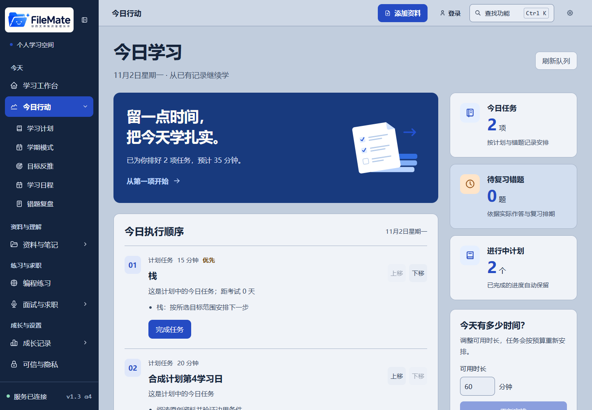
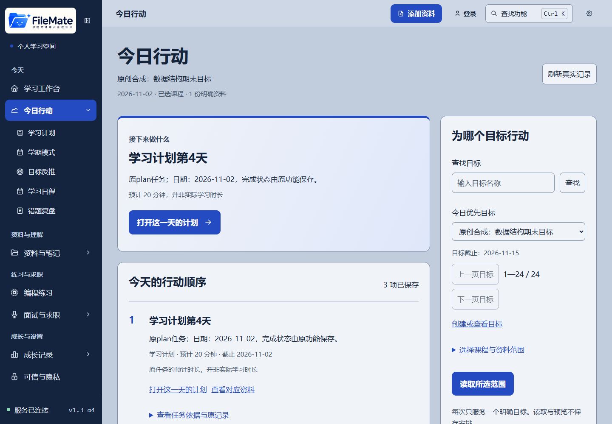

# Learning Orchestrator 2.0 · C级交付候选

2026-11-02。用户已批准八项计划逐项实施。“今日行动”工作台、原入口定位、确认恢复和真实浏览器验收已完成；扩展运行时回归18项通过，真实旧运行时与容量通过。全量门禁正在运行，最终独立审阅尚未开始；C待验收，D／E及部署未启动。最终结果以[验证清单](audits/learning-orchestrator-c-2026-11-01/verification.json)和[审阅记录](audits/learning-orchestrator-c-2026-11-01/review.md)为准。

## C1—C5交付矩阵

| 要求 | 已实现行为 | 证据 |
|---|---|---|
| C1 知道目标、原因、开始和下一步 | 一个“今日行动”导航；显式选择目标、课程／资料、预算；显示规则理由与原任务入口 | 实际浏览器目标创建、草稿编辑、预览确认、原领域完成和返回 |
| C2 目标／安排／反馈 | 已保存安排与未确认草稿分开；今日资料作答与无逐项时间的历史完成分开；最多5条概念证据按需核验 | 控制器行为测试、实际作答与回执、非空历史指纹 |
| C3 日常／碎片／冲刺 | 同一工作台的三个主动显示模式；切换不自行重排或写目标 | 浏览器切换模式无确认写入、目标原记录摘要不变 |
| C4 既定设计与多端 | A级已选A方案；沿用蓝色、四主题、大号无衬线字、SVG和44px操作目标；抽屉焦点约束及键盘排序 | 1440／1024／390／320px截图、四主题抽样对比度≥4.5、实际Microsoft YaHei字体 |
| C5 精确原入口 | 目标不在前20条仍精确读取；计划天数映射真实索引；学期任务后续分页；错题别名；无编程题ID显示明确选择入口 | 浏览器真实第7天／索引2、任务75／第3页、原文与图谱证据、面试／编程跳转 |

## 使用方法与恢复

1. API设置`FILEMATE_ENABLE_LEARNING_ORCHESTRATOR=1`后重启；默认0，仅明确关闭时展示保留的旧版今日页。401／503／断网和不兼容合同显示实际状态。
2. 在“今日行动”选择明确目标和最多20份资料，设置分钟预算；候选最多200、选中最多20，目录每页30。编辑的是本次候选安排，目标原文、截止日期和历史完成不会被重排覆盖。
3. 可固定顺序、使用上下移按钮、调整时长或排除候选；先“预览安排”，再确认保存。0分钟预算可预览为空。日常、碎片、冲刺视图复用同一安排。
4. 点击任务回到原领域执行，完成证据由原功能保存；工作台不提供虚假的统一“完成”写入。查看资料原文、实际错题和概念依据后再练习。
5. 确认响应丢失时，保留原请求键并点击“查找原请求回执”；404仍表示未确定，不自动更换键或重复写入。已有直达回执不会被后续日查询失败抹除；刷新可恢复已确认安排和最新回执入口。
6. 撤销单独预览并确认，仅撤销本次未被改动的安排。退出账号或恢复备份清除本机待决定位与旧令牌；离线保留已编辑草稿并明确错误。

## 测试和兼容

- [浏览器74项／14阶段](audits/learning-orchestrator-c-2026-11-01/browser.md)：真实Edge、真实FastAPI和SQLite、原创合成资料；包含丢响应、404／409／429／503／401、离线、双页冲突、删除来源、签名备份恢复、空数据和迟到响应。预期故障会产生控制台网络错误；最终各阶段没有未捕获页面异常。
- [容量](audits/learning-orchestrator-c-2026-11-01/performance.json)：100／1000／10000条本域错题加等量外域，每域到期时间各不相同；暖P95分别22.20／12.51／40.50ms，四并发P95分别35.95／42.23／160.16ms，最大响应173849字节；沿用500ms与512KiB门槛。冷请求51.75／35.57／66.03ms，完整阶段耗时及运行环境单独归档。这是本机直接应用链测量，不是生产HTTP负载结论。
- [真实旧环境](audits/learning-orchestrator-c-2026-11-01/target-runtime.json)：Linux Python3.11.13／SQLite3.26.0，指定源码09727b6；整应用及真实HTTP通过，新增元数据／标签／持久化回执可读。原创schema34数据升级至36保留旧字段、完成状态与错题，integrity ok／外键错误0；升级前备份可由旧代码读回34。仅新建/tmp隔离环境，不写生产库或切换现役服务，认证停止临时API已验证。
- 非空保护夹具含原评分回答、确认知识关系／来源证据、复习历史和已完成计划；调度确认／撤销保持全业务指纹不变。备份恢复按现役安全规则更新面试版本、撤销旧授权，分别严格验证这些变化；原评分／关系／作答／计划字段逐项保持，不以整表排除掩盖丢失。
- C不新增migration；生产仍有前专项34→36升级，不称零迁移。旧B产物缺日回执指针时继续可读且返回null；不扫描全部操作假造回执。
- Task7默认门禁的npm ci曾被运行中Vite的原生二进制锁阻断，失败全日志保留。最终使用项目已有`-IsolateFrontend`执行相同测试、构建与体积门槛，不升级依赖或提高预算。

## 视觉对照

| 原今日页 | C级工作台 |
|---|---|
|  |  |

[手机实际截图](audits/learning-orchestrator-c-2026-11-01/final-mobile.png)；[深色主题](audits/learning-orchestrator-c-2026-11-01/visual-midnight.png)。全部示例标记为原创合成工程资料，不表示真实学生研究。

## 已知限制与阶段边界

真实学生学习效果未采集；没有新“掌握率”或AI猜测评分。实体手机输入法、实际浏览器200%缩放、Safari／Firefox及生产流量未验；当前仅已测有效CSS视口和缩短输入区。旧版错题目录不支持精确聚焦时明示目录回退。大编辑器既有构建警告及很小的初始gzip余量继续保留。超过样本容量、混合旧日期分布／无JSON1的同等性能未证明。D级按需AI教练、E级整合发布以及正式部署均等待相应阶段确认。
