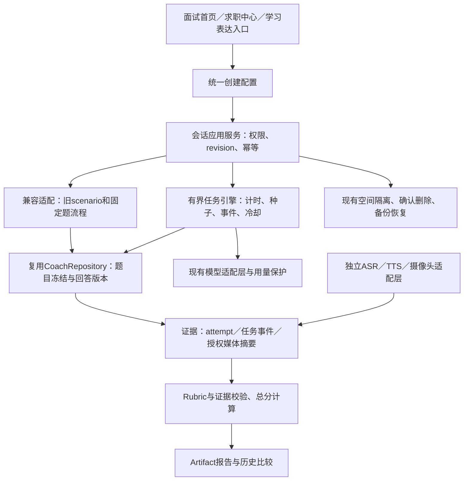

# Interview 2.0 第一阶段结构与兼容设计

2026-10-19。状态：**第一阶段与第二阶段范围已获用户确认；第二阶段独立分支实现与验证完成，等待阶段验收。**

本文件与[审计报告](../../INTERVIEW_2_0_PHASE1_AUDIT_2026-10-19.md)合读。仅用于第一阶段的重组方案与后续分期边界，不是已经批准的全面实施计划。

## 1. 目标、边界与依据

目标：把现有逐题训练扩展成可恢复、有证据的学生场景化训练。用户确认知识／电商主播双场景，十分钟实战优先，摄像头只做回看与可观察动作，报告共享结构但按场景评分。

沿用Vue 3、TypeScript、FastAPI、SQLite、现有模型与自然语音适配层。第一阶段不改产品代码、schema、API或线上部署。没有真实专家标注时，评分始终为待校准的训练参考；不把无证据维度补零或用均值填补。

明确不做：情绪识别、人脸身份库、后台监控、自动录用／淘汰、真实商品交易、未经授权抓取媒体、伪造用户效果、声称所有浏览器离线ASR。

## 2. 分类重组与新旧映射

新配置分开保存`category`、`track`、`language`、`difficulty_strategy`、`question_strategy`；显示名称不再充当所有业务规则的唯一开关。

| 旧入口／数据值 | 新位置 | 兼容规则 |
| --- | --- | --- |
| 求职面试 | 通用求职／综合 | 保留原scenario，分类投影为general；历史题目不重生成 |
| HR面 | 通用求职／HR | 新track=hr；原会话原样可读 |
| 技术面 | 专业技术／岗位技术 | technical＋岗位主题；保留旧固定题和追问 |
| 算法面 | 专业技术／算法 | technical＋algorithm；不与编程OJ判题混为一套评分 |
| 项目面 | 项目答辩与综合／项目经历 | project＋project；项目事实仍由用户提供 |
| 竞赛答辩 | 项目答辩与综合／竞赛 | project＋competition；保留旧题库关联 |
| 保研复试 | 项目答辩与综合／学术复试 | project＋academic；保留学术场景差异，不改成企业求职 |
| 英语面 | 原场景＋英文语言 | 旧记录没有更具体方向时投影为general、en-US并标明来自旧英语模式，不臆测技术方向 |
| 压力面 | 原场景＋挑战追问策略 | 旧记录缺方向时general＋challenge；仅规则变化，不自动提高或降低能力分 |
| 知识讲解 | 独立“学习表达训练”入口 | learning_expression；保留本地分析限制和资料／错题／目标关联 |
| 新增知识主播 | 主播与内容表达／知识 | creator＋knowledge；独立授权，不绕过旧知识讲解保护 |
| 新增电商主播 | 主播与内容表达／电商 | creator＋commerce；合成或授权商品资料，不生成虚假功效、价格或销售承诺 |

未知历史值显示“旧版训练”，保留原值并允许回看；禁止默默改为求职面试。页面是四个核心方向，学习表达另一个关联入口，不强行混入企业面试。

## 3. 模块架构

复用现有`interview_coach`与`interview_review`，不新建重复的用户画像和原始回答仓库。`server.py`逐步抽出路由，`Interview.vue`分成首页、配置、训练、报告、历史页面；共享composable持有业务状态，组件持有短暂的设备资源。

只有一个应用服务有权推进新引擎会话。旧`/answers`、`/coach/advance`不能绕过新任务状态；旧客户端对新动态会话应返回明确的升级／只读提示。旧固定题会话继续使用原合同。

## 4. 任务引擎提案（第三阶段，不在第二阶段实现）

状态为准备→进行→任务／事件→等待回答→任务切换→结束／中断→复盘。复用答案版本，任务和事件只保存答案引用，不复制原文。

- 服务端持久化目标时长、起点／截止时间、状态、当前任务、固定种子、事件序号、已选题ID及冷却到期；前端倒计时只作投影。
- 用户已确认开始后连续计时，刷新／断网不重置；允许主动提前结束，不实现暂停。到期和主动结束是不同结束原因。第三阶段才启用服务端计时。
- 固定种子、事件ID与request_key保证重试不重复抽题／刷评论。每次动作检查revision、当前任务、截止时间和授权，事务提交后才返回。
- 模型只建议下一步；服务端校验合法任务、证据、冷却与预算。过期、重复、取消后的模型结果不触发新任务；故障保留回答并提供明确的规则任务或重试。
- 建议工程上限：单场30个观众事件、冷却至少15秒、最多12个外部AI操作（格式纠正也计数），再叠加现有空间额度与调用超时；具体阈值留给第三阶段性能验证调整并记录配置版本。
- 知识／电商分别配置任务池。自我展示、即兴、虚拟评论、可跳过挑战共用引擎；电商评论仅围绕已提供商品事实，规则检查不能宣称能保证所有生成内容合规。
- 完整十分钟验收必须真实经过墙钟10分钟，使用合成岗位／商品和授权测试数据；快进计时的单测不能替代。需包含刷新恢复、网络／模型失败、提前结束、冷却去重和报告证据。

## 5. 数据库兼容与迁移

第一阶段审计时迁移最高为27；第二阶段新增28（配置快照与空间内草稿），不修改既有迁移、不清库重建。十分钟／标准／中文为快速配置；设备默认关闭，AI另行授权。

| 阶段 | 拟新增结构 | 约束和兼容 |
| --- | --- | --- |
| 第二阶段 | `interview_session_config`、带空间隔离的配置草稿 | session的1:1外键，保存schema_version、category／track／language、时长、策略和设备偏好；偏好不等于已经取得浏览器权限或外发许可 |
| 后续选题统一 | 题目分类facets及必要的新题目记录结构 | 旧题库三类限制仍须兼容；旧题ID和正文保留，不能只扩大前端枚举。新表／新列方案在该任务卡确定 |
| 第三阶段 | `interview_runtime`、`interview_tasks`、`interview_events` | session外键，唯一(session,seq)、唯一(session,event_key)，任务绑定稳定question_index；事件引用attempt，不复制回答；按session／序号索引 |
| 第六阶段 | `interview_rubrics`、`interview_assessments` | Rubric的ID＋版本不可变；评估引用attempt／run、任务证据、Rubric快照；报告还是Artifact，旧报告不覆盖 |

兼容策略：先按旧scenario做只读映射；新建／编辑时写新配置快照。历史记录不批量重命名，不重新出题，不默认授予AI／媒体许可；不把四维旧结果转换成六维新结果。不明确的历史时长显示未记录。

迁移事务必须验证幂等、外键、旧session／turn／attempt行数和内容哈希；版本26→27既有回填继续保留。新增配置应可缺省读取，损坏配置显示可恢复错误，原回答仍可访问。

每引入一张表，同步更新个人导出／备份、确认删除作用范围、全版本清空、恢复规范化和管理员恢复。恢复时撤销外发授权，运行中任务变为中断／需用户继续，禁止自动重放AI或重新开启设备。

回滚区分两种：

1. 功能关闭：先关新写入，读旧记录／导出／删除仍可用；隐藏新入口，动态会话只读，schema保留，禁止旧客户端继续推进。
2. 二进制／数据库回退：旧版本是否能读新增表需实测，不能承诺任意降级。迁移前做一致性备份与manifest，恢复到新目录并验证，再人工切换；恢复到旧快照可能丢失之后的新数据，必须预览范围并确认，不静默覆盖。

## 6. 证据、评分和隐私合同

现有`interview-excerpts-v1`与`four-dim-six-area-v1`可追溯字段继续保存。新Rubric每维包含ID／名称、范围、权重、评分锚点、原文或任务证据、理由、模型／规则版本、证据充足性和建议。

总分由服务端根据有效维度与权重计算。核心维度缺证据时`overall_score=null`且报告标为不完整；非核心维度的缺失和归一化规则必须随Rubric快照保存。不能给雷达缺失轴填0／均值，改成缺口标记和可读表格。

仅文字时，音频清晰度、语调、真实停顿等均待采集；追问应变需任务事件与回应证据。中文ASR回调节奏从新评分中移除，旧成绩保留旧版本说明，不在历史上悄悄重算。跨场比较只使用可比的场景、Rubric版本、语言与证据条件，来源变化显示不可比。

摄像头、麦克风、识别、录像、外发文字分析、朗读逐项说明；关闭一个不能暗中开启另一个。摄像头无授权也能完成核心训练。音视频默认不上传，当前页面内存录像的限制在UI显式说明。若将来持久化本机媒体，需单独确定容量、导出、删除和恢复策略。

现有2Hz Worker、初始化30秒超时、30分钟上限可以复用；需另测权限拒绝、切设备、轨道ended、背景页、低配CPU、低光和模型加载失败。无身份识别／情绪标签；客户端观察不是用于淘汰候选人的可信指标。日志保存引用、有限错误码及版本，不保存密钥、媒体帧或回答正文。

## 7. UI结构与响应式

见[六页结构草图](../../design/interview-2-phase1.svg)，为布局提案，不是产品截图。

| 页面 | 主要信息与动作 | 次要内容 |
| --- | --- | --- |
| 首页 | 四方向＋继续训练＋一个快速开始 | 学习表达入口、最近训练；题库管理在已有导航下展开 |
| 配置 | 目标／类型、时长、策略摘要、开始按钮 | 语言难度和设备／隐私高级设置；显示实际可用能力 |
| 进行 | 当前问题／任务、大号剩余时间、回答区、提交／结束 | 桌面右侧设备和教练；手机折叠，拒绝摄像头仍正常 |
| 主播专项 | 当前挑战、授权内容事实、可回应的观众评论 | 设备、倒计时、可跳过挑战；评论有冷却且不滚动轰炸 |
| 报告 | 完整性状态、六维卡、证据与下一步 | 雷达＋表格替代、时间轴、原文、PDF；无证据不画分数 |
| 历史 | 最近会话、继续／回看、同口径比较 | 场景／版本筛选、专项练习；录像不可用时说明原因 |

沿用`design-system/filemate/MASTER.md`最新四主题与系统跟随，中文无衬线，保留LOGO和蓝色。正文≥17px、辅助≥15px、主问题约28–36px、触控≥44px；不新增宋体／花体／Emoji或突然黄色撞色。键盘焦点、aria-live错误、减少动态效果、暂停朗读入口均保留。

1920桌面主任务约占2/3，设备侧栏约1/3；1366×768默认先看到任务和主按钮；移动端单列，当前任务／输入优先，设备与历史后置。计时不每秒向屏幕阅读器播报；到关键阈值再提示。所有加载、空数据、拒权、保存失败、分析失败及网络中断都有明确的保留内容与下一步。

## 8. 分期顺序和停止点

| 阶段 | 交付边界 | 阶段验收后再继续 |
| --- | --- | --- |
| 1 当前 | 审计、分类映射、兼容方案、结构草图和问题 | 等待整体方案确认 |
| 2 | 统一创建／配置、分类合同、草稿／配置恢复和权限状态；兼容当前固定题运行 | 时长／混合／主播未交付时明确不可运行；不冒充已实现 |
| 3 | 有界限时引擎＋知识／电商主播任务＋持久化事件 | 真实10分钟合成／授权数据验收；报告可先复用现有原文证据报告，不能假称六维评分完成 |
| 4 | ASR／TTS与客观音频证据，独立录音回放导出 | 真音频、拒权、断连、无样本／置信度缺失分别展示 |
| 5 | 摄像头设备选择、可靠录像、画面与可观察动作 | 真实授权设备记录，注明失败与兼容边界 |
| 6 | 场景化六维Rubric、可重算报告与可比历史 | 证据不足／模型失败／版本变更测试；专家校准仍需真实数据 |
| 7 | 学生功能稳定后再设计高校／企业受控试点 | ACL、知情同意、人工复核、保留期、纠错与公平性评估 |
| 8 | 基于实际能力完成全套UI与响应式打磨 | 三尺寸、键盘、错误和故障恢复验收 |

第二阶段只在报告E节确认后编写具体实施任务。工程师可自行决定内部文件名、组件拆分细节和索引命名；不能自行改变用户对象、主播范围、评分用途或授权规则。

## 9. 技能使用和依据

- 已读取本机UI/UX Pro Max并运行设计系统、UX、Vue检索。其自动配色／活动报名页／字体建议与现有品牌和任务不符，未采纳；采用其中错误恢复、错误播报与副作用清理建议，现有MASTER优先。
- 已读取Vue 3技能，以及security-best-practices的FastAPI／Vue／浏览器安全参考，核查实际空间路由、权限、证据输入、有限重试及日志边界。本轮不是全站渗透测试。
- 使用本机Playwright CLI进行隔离浏览器审计，并运行现有pytest／Node测试；未声称调用独立FastAPI技能。技能目录中FastAPI安全参考可用，未找到专用FastAPI开发技能。
- 已按brainstorming技能完成独立builder check，结论为`nothing important left`；审阅明确排除了报告E节已列出的三项待确认选择。审阅记录保存在审计证据目录，不代替用户要求的阶段确认。
