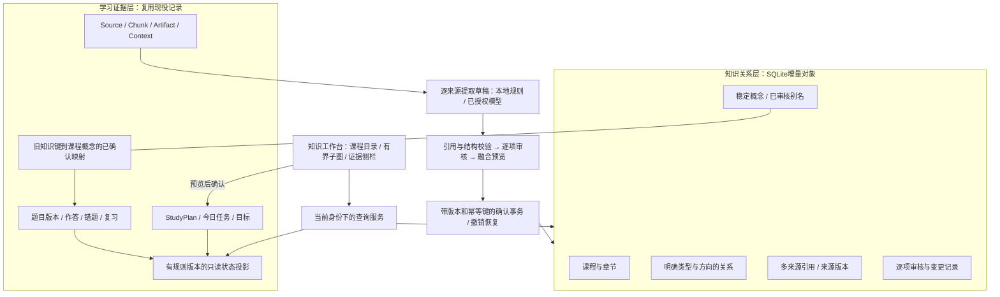
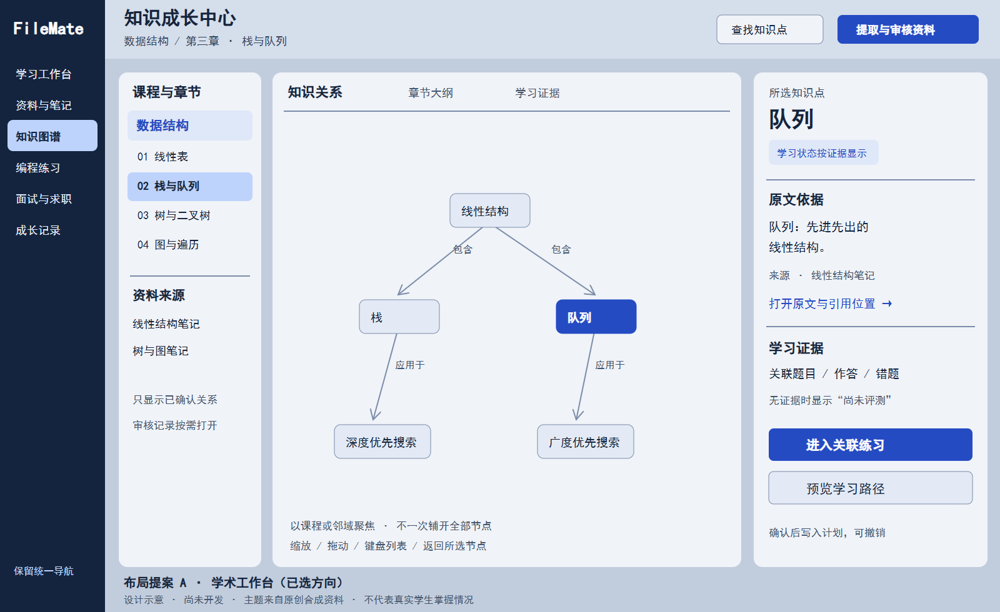
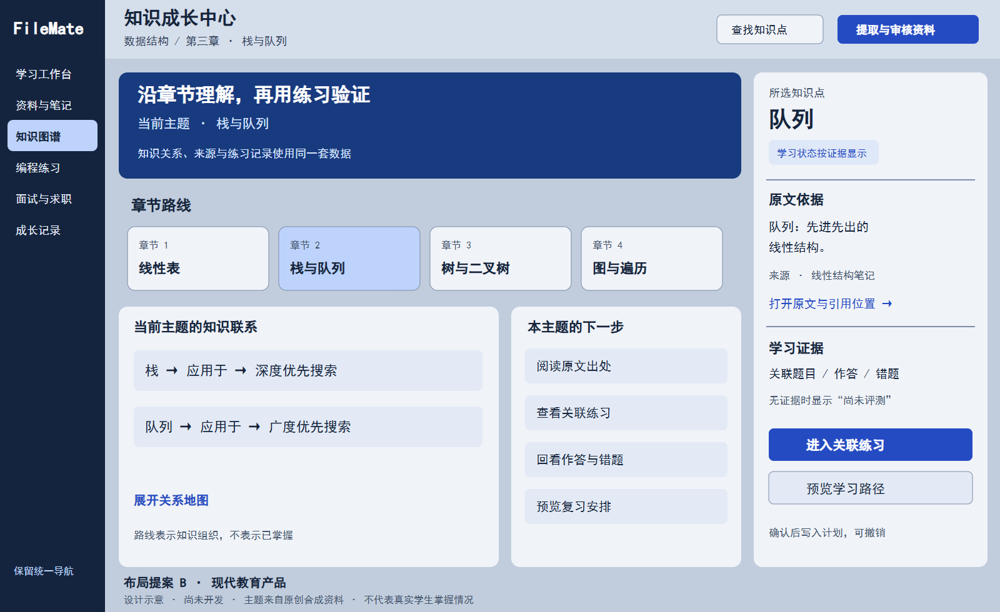
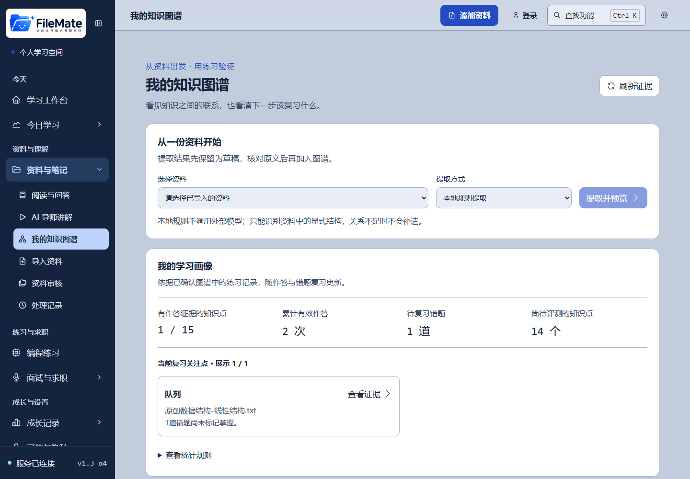
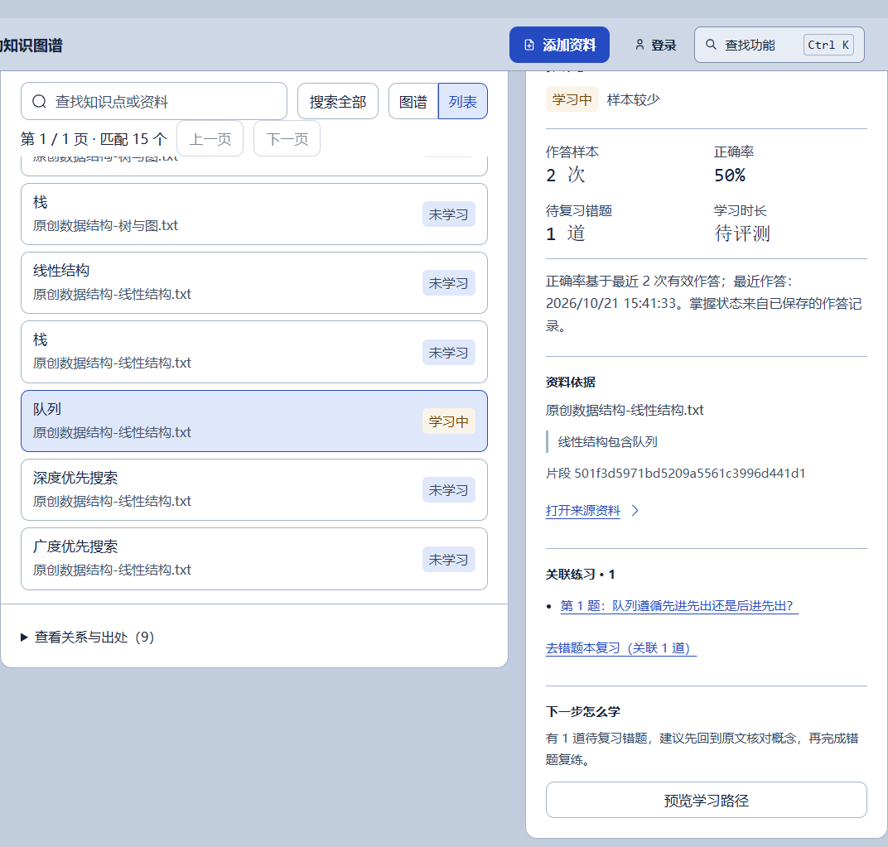

# FileMate Knowledge Graph 2.0 — A级审计与总体设计

日期：2026-10-21启动，2026-10-22完成审计并获用户明确“A级通过”。状态：**A级已通过；B级实现计划待审阅，尚未实施；C—E未开始**。冻结日期沿用首轮答复暂记10月23日，不因跨夜自动顺延。

本轮结论：现役 V2.2 有可运行的“资料→草稿→确认图谱→练习证据→学习计划”基础，适合增量升级；尚不能称为课程级、多资料融合的知识成长中心。建议保留 Vue / FastAPI / SQLite / ECharts，先处理概念身份、逐项审核与证据绑定，再重构工作台。两天内不承诺完成 A—E 全专项。

## 1. 本级目标与决策

### 用户已决定

| 事项 | 已确认方向 |
|---|---|
| 演示冻结 | 两天后；按本次讨论日期暂记 2026-10-23，具体冻结时刻未指定 |
| 首批课程 | 先数据结构，再增加第二门课程验证隔离 |
| 概念范围 | 同一课程内审核后合并；不同课程分别保留，由用户建立联系 |
| 界面方向 | 学术工作台：课程目录＋大画布＋证据侧栏 |
| 推进方式 | 一次一级；先提问、等待回答；完成后等待明确“A级通过”等验收 |

本级只核实现状、提出架构和排期、保存实际测试证据与设计示意。不新增业务功能，不执行生产迁移，不部署未验收候选。

### 基线和事实源

- 实际工作区：`C:/Users/胡希/.codex/worktrees/release-alpha3/FileMate-Project`；本级分支 `codex/knowledge-graph-2-audit`，父版本 `8565d507498ee270f6594872554ac904a77d0f30`。
- 名义目录 `D:/FileMate-Project` 用于本轮 `_working` 证据，不把另一份旧检出当成现役代码。
- 业务迁移最高版本 30；图谱批次来自 migration18，图谱操作事件来自 migration21。本轮新建的隔离数据库经实际初始化验证为30，不是凭文档推测生产库版本。
- [最新生产回执](../../INTERVIEW_2_0_RELEASE_2026-10-21.md)记载 Web `3bac02e8`、API `878124b5`、业务schema30。本轮未登录生产服务器重新验库，也未修改线上版本。
- 当前工作区原有24个测试文件的修改状态保留，不归入本级提交；与此前保存的24文件哈希基线逐项比对一致，本级未编辑这些文件。

实际依赖：锁文件 Vue3.5.40、Vite8.1.5、TypeScript6.0.3、ECharts6.1.0、vue-echarts8.0.1、Pinia4.0.2、Vue Router4.6.4、Tauri CLI2.11.4；本地 Python 环境 FastAPI0.141.1、Pydantic2.13.4、Uvicorn0.52.1、SQLite3.53.1。`pyproject.toml` 的范围声明不等于本地安装版本；桌面壳不在本轮运行验收范围。

### 技能检查

实际使用 brainstorming 组织设计、UI/UX Pro Max 查询布局与可访问性、Vue3最佳实践核对现有响应式与生命周期、Playwright 运行浏览器复核、security-best-practices 核对 FastAPI 对象权限和 Vue 文本渲染、verification-before-completion 核对新鲜证据。systematic-debugging 用于定位本轮审计脚本的失败。

未发现独立的 FastAPI、TypeScript、SQLite迁移专用技能包；安全技能附带 FastAPI/Vue 参考，不能冒称安装了额外技能。Vue技能主文已读，其目录未包含所引用的 shallow-ref / lifecycle-cleanup 单独规则文件；使用已存在的computed规则与Vue官方性能文档补充核对。UI/UX搜索返回的儿童教育字体、青绿色及FAQ首页建议与用户方向不符，未采用；沿用现有无衬线字体与蓝色主题。

## 2. 已核实的实现、差距与问题

状态含义：“可复用”表示当前代码与本轮匹配范围测试支持；“部分”表示有实现但不足2.0要求；“缺失”指审计范围中未找到对应业务能力，不是只因没有页面按钮而判断。

### 2.1 功能审计矩阵

| 功能 | 状态 | 代码位置（仓库相对路径） | 真实问题或边界 | 修改建议 |
|---|---|---|---|---|
| 页面与导航 | 可复用 | `web/src/router/index.ts:85`、`web/src/views/KnowledgeGraph.vue`（均位于`filemate/`） | 现役入口存在，开关关闭时转回学习工作区 | 保留旧URL和导航；不增加第二套顶栏业务入口 |
| 资料导入、解析、检索分块 | 可复用 | `server.py:1897`；`filemate/perception/`、`understanding/retrieval.py` | 单文件最大25MiB；解析可有截断，图谱仅取前20,000字符 | 复用Source和document_chunks；明确每次提取覆盖范围 |
| 本地知识提取 | 部分 | `filemate/study/knowledge_graph.py:110` | 标题、定义、有限明确关系句；每批最多80节点/120关系；非通用教材理解器 | 作为离线规则基线；多资料逐源提取，不靠固定虚假结果补全 |
| 模型知识提取 | 部分，质量待验证 | 同文件`LLMGraphProvider:27`；`server.py:1757` | 适配器和失败恢复存在；JSON解析后调用自定义校验，未向客户端传专用JSON Schema；并非已有高质量提取评测 | 增加明确Schema、逐项校验与质量用例；保留模型不可用状态 |
| 模型超时与重试 | 可复用但需总时限设计 | `filemate/llm_client/client.py:105`；图谱Provider | 每次调用45秒、retry=1（一次尝试），引用校验失败最多重新提取一次；不存在图谱提取全过程统一deadline | B级按总时限/取消规则收口；不能无限重试或失败保存成功内容 |
| 原文与片段引用 | 部分 | `knowledge_graph.py:171`；`storage.py:3610` | 引文须为连续原文，节点须含术语，关系须同时含两端；片段与页码能匹配则附带，否则可能为空 | 保留Source版本、片段与字符位置；缺页码明确显示，不补造定位 |
| 关系语义和方向 | 必须加固 | `knowledge_graph.py:171` | 校验“引用存在”不能证明“前置/包含/应用”的语义成立；已复现不支持的前置边仍过校验 | 关系类型/方向逐项审核；规则识别只接受明确语句，复杂模型候选保持待核对 |
| 草稿、确认、撤销、恢复 | 可复用 | `storage.py:3610–3745`；`server.py:1805` | 事务、来源版本、幂等状态转换已具备 | 作为兼容底座，不改旧批次不可变payload |
| 逐概念/逐关系审核与编辑 | 缺失 | 当前`transition_graph_batch`和页面批次操作 | 当前是整批确认/撤销；没有独立关系拒绝、术语修订和合并审核 | B级新增逐项决策，批量确认只能作用于已检查项 |
| 跨资料融合与别名 | 缺失 | `storage.py:669 _knowledge_identity` | ID取Source范围＋规范化标签；三份资料的“栈”得到三个ID | 增加课程内稳定概念及来源映射；先预览再合并，保留旧标识 |
| 课程/章节管理 | 部分元数据基础，缺少图谱领域模型 | Source.metadata；`understanding/entity_extractor.py` | 归档实体提取的course_name不是课程图谱主键；未找到课程/章节专表 | 新增明确课程边界；章节用稳定标识关联来源片段，不按文件名猜测 |
| 图谱显示、搜索、详情 | 可复用 | `KnowledgeGraph.vue:267`；`graph_projection.py:8` | ECharts Canvas；60节点以上切圆形布局；地图最多100节点、API最多200节点/页 | 保留渲染器，按课程/章节/邻域返回有界子图；跨页关系明确提示 |
| 学习状态与薄弱点 | 部分 | `knowledge_graph.py:223,269,307` | 基于实际QuizAttempt/WrongQuestion；最近10次样本；无样本正确率null；状态文字却可能显示“未学习/基本掌握/熟练” | 统一为“尚未评测/已有练习/需巩固/近期稳定”等证据状态，保留规则版本与样本口径 |
| 题目与作答关联 | 可复用，范围有限 | `knowledge_graph.py:337`；`storage.py:3746` | 依赖持久化题目knowledge_point和同Source键匹配；不同表述、代码题目录节点不会自动关联 | 使用显式映射；审核别名不可自动把所有同词题目归并 |
| 题目修订与历史隔离 | 可复用 | `storage.py`题集修订与快照；`test_graph_storage.py` | 已保留旧题、旧作答；过期作答请求409 | 保留现有版本边界，不能因概念合并重写历史题目 |
| 来源更新与过期引用 | 部分，需延续兼容规则 | `storage.py:1174`；`knowledge_graph.py:313`；`API_SPEC.md`图谱合同 | Source正文会被更新，revision为内容指纹，不是完整历史版本库；现役聚合排除过期批次 | 新对象按来源版本判断有效性；多来源保留仍有效依据，重新提取重新审核，不能承诺恢复不存在的历史正文 |
| 错题与间隔复习 | 部分联动 | `wrong_questions`；`daily_coach.py`；`/review/today` | 图谱有wrong_ids；跳转目前到全局错题本；复习调度可用，但节点没有完整复习时间线 | D级补概念筛选深链与review evidence；不把标记掌握当作永久能力 |
| 图谱学习计划 | 可复用，策略有限 | `knowledge_graph.py:413,449`；`storage.py:3789` | 确认前置边→预览指纹→新增StudyPlan/Artifact；重复确认不重复；策略固定每天30分钟，每节点一天 | 复用写入、撤销、恢复；D级再纳入用户时间与目标 |
| 今日学习、目标 | 部分联动 | `server.py:3851`、`study/goal_planner.py` | 现有计划可进入今日队列；完成粒度为计划天，图谱未消费其完成记录作为节点证据 | D级显式联通任务与概念，不把计划打勾等同题目答对 |
| 知识卡/笔记/导师问答 | 共用资料基础可复用 | Source/Artifact/Context；`LearningWorkspace.vue`、`LearningEvidencePanel.vue` | 节点可打开来源和已有题集，但没有独立概念卡/限定上下文问答入口 | 复用现有产物与授权，不为图谱再建一套知识库 |
| 编程、技能树与成长 | 部分基础 | `programming/problems.py`、`study/skills.py`、`study/evidence_profile.py` | `programming:*`题库概念不是个人图谱节点；技能树独立criterion；成长也有独立口径 | D/E通过审核映射复用，不把目录标签或AI点评算掌握证据 |
| 图谱问答与有限Agent | 尚缺图谱专用链 | 通用Agent/问答存在，图谱模块未见同等入口 | 无完整“已确认关系＋来源＋个人证据”问答与路径建议工具链 | E级建立只读检索、有限建议、用户确认写计划；不授予数据删除权限 |
| 历史与数据删除 | 可复用但要扩展 | `knowledge_graph_events`；`storage.py:1364`、`data_actions` | 批次和事件随Source级联删除；最近100事件；本级没有新增数据对象 | B级新概念多来源后重新计算删除影响，不能沿用单Source级联语义 |
| 性能保护 | 部分 | `storage.py:760`、`graph_projection.py` | WAL只读快照＋每空间聚合锁；先全量聚合再搜索分页，节点详情也全量构建；历史/计划增长仍有成本 | 先测后改；B结构化索引，C邻域加载，E做证据密集和并发评测 |

代码路径缩写仅为表格阅读；后端文件均以仓库根为准，前端在`filemate/web/`。这是代码审计矩阵，不把所有“可复用”解释为2.0整体验收通过。

### 2.2 历史材料差异

1. `docs/ARCHITECTURE.md` 原前言写SQLite v9，并将认证/云部署列为规划；当前迁移已到30，账号、HTTP身份隔离及线上发布回执均存在。本级只更正其现役边界说明，架构正文仍保留为目标设计。
2. `docs/AGENT_DEVELOPMENT_EXECUTION_PLAN.md` 的历史首段停在面试第三阶段本地状态。本级在开头链接最新发布回执，不改写历史验收事实。
3. [V2.2原交付](../../V2_2_KNOWLEDGE_GRAPH_DELIVERY.md)明确区分了授权教材、本地提取、自编题和真实用户研究：其闭环未调用外部LLM，未完成模型提取质量测量。不能把此前教材闭环成功当成模型已可靠。
4. [技术白皮书](../../FILEMATE_2.0_TECH_WHITEPAPER.md)提出的是2.0技术方向；向量库、Neo4j、GraphRAG及科研收益尚无本级运行证据。已存在通用Agent不等于图谱学习Agent已完成。

### 2.3 优先问题清单

这里的P1同时包含2.0发布阻塞性缺项，不代表旧版发生相应运行故障。

| 编号 | 级别 | 证据与影响 | 应处理等级 |
|---|---|---|---|
| KG-01 | P1 质量边界 | “栈和队列都是线性结构。”可被作为栈→队列的prerequisite引用通过校验；关系事实仍需审核 | B |
| KG-02 | P1 功能缺项 | 同课程多资料没有统一概念/别名；同词可能重复，证据分散 | B |
| KG-03 | P1 功能缺项 | 只支持整批审核，无法独立拒绝一条错误关系或撤销一次合并 | B |
| KG-04 | P1 兼容风险 | 若直接重写现有knowledge_key，历史题集、错题与计划可能失联 | B设计与迁移必须保留旧键 |
| KG-05 | P2 交互 | 1366×768页面地图面板起点约1015px；1024×768约1097px。首屏几乎看不到图谱 | C |
| KG-06 | P2 表达 | 无样本状态“未学习”、高样本“熟练”容易被理解为能力测量；标签/线条有硬编码颜色 | C/D |
| KG-07 | P2 规模 | 全量聚合后分页；地图100节点/页不是万节点全图布局能力 | B/C/E按阶段补证据 |
| KG-08 | P2 文档 | 旧schema与规划材料容易误导答辩、研发和发布判断 | A已纠正边界说明 |

本级未发现可据此确认的新增P0漏洞；范围限定为图谱及其联动，不宣称完成全站渗透测试。

## 3. 总体架构与数据方案（候选，未实施）

### 3.1 双层架构

知识关系说明“知识之间如何联系”；学习证据说明“这个用户做过什么”。二者不互相冒充。模型、阅读次数或节点数量不能直接写出掌握度。AI说明、教材事实、个人作答事实在界面上分开标注。

### 3.2 候选持久化对象

下列是B级待冻结的增量模型，不是本级已创建的表。先复用，再按查询/约束需要确定DDL。版本只能在B开工重新核对迁移头后追加，**不预占31、不修改已发布迁移**。

| 候选对象 | 现有等价/基础 | 建议处理 |
|---|---|---|
| 课程/章节 | Source.metadata、归档course_name，尚非稳定领域身份 | 课程使用独立稳定ID；章节作为课程内稳定对象/课程大纲产物，片段映射记录章节ID；B实现计划冻结具体存储方式 |
| KnowledgeConcept | 批次payload中的节点，ID绑定Source | 新课程概念ID独立于标签和资料；改名/合并不重写旧题目键；状态pending/confirmed/rejected/revoked |
| KnowledgeRelation | 批次payload中的边 | 结构化存储course_id、from/to、受控type、审核状态与版本；课程内关系两端的约束由DB与服务共同保证；跨课程联系需独立语义，不能借此绕过课程隔离 |
| KnowledgeEvidence | node/edge excerpt、chunk/page、source_revision | 多条来源记录；关联Source及版本，记录片段/范围与提取范围；概念证据和关系证据使用可验证外键，避免无法约束的任意target字符串 |
| ConceptAlias | 无独立对象 | 课程内候选别名，用户确认后生效；Stack/栈只是候选，队列/优先队列不得默认合并；歧义别名不能强制指向唯一概念 |
| 旧键映射/概念出现 | `_knowledge_identity`、payload node_id | 以course＋source＋revision＋legacy_node_id绑定稳定概念；只新增映射，保留原始题集和知识键；一条学习记录多来源命中时按record_id去重 |
| ConceptReview | 批次状态、graph_events | 新概念/关系使用独立状态与逐项决策记录，不为每种审核再建平行系统；整批只是操作容器 |
| ConceptLearningEvidence | QuizAttempt/WrongQuestion、题集快照、StudyPlan | 继续读现役记录；D级才新增必要的显式关联记录，不复制全部历史学习数据 |
| ConceptLearningState | 现有metrics与profile只读计算 | 优先只读投影；有规则版本、时间窗、样本量和记录ID。确需缓存时可重建，不能成为新的事实来源 |
| GraphChangeLog | knowledge_graph_events | 旧事件保留；课程级合并/撤销不能依赖“非空source_id且删除来源会级联”的旧表合同；增量变更日志仅记必要元数据并参与隐私删除 |

暂不为全部候选对象各建一张表。预计新增的核心持久化集合是课程边界、课程概念、关系、多来源/旧键映射、别名与审核变更；章节与学习状态能否复用Artifact/只读投影，在B级明确DDL前决定。A阶段不以表数量作为交付承诺。

### 3.3 不可破坏的兼容与事务边界

- 当前按身份选择数据库，`workspace_id=local`不能被误当成全站同一个用户。所有新增查询沿用当前租户存储，不能新增一个全站图谱共享文件。
- 旧Source/Artifact/Context、旧节点ID和`knowledge_key`继续可读；旧批次payload不可变。历史来源无法确认课程时放“未归类”，不按文件名自动归课。
- 单份Source可被用户用于多个课程；每个课程产生独立概念映射，不自动跨课累计表现。跨课联系是显式关联，不是共享同一个概念ID。用户已确认B做课程隔离，D再增加用户建立的“相关概念”联系；联系不作为跨课前置依赖，也不转移作答或掌握证据。该范围决策不替代各级验收。
- 合并预览显示候选概念、全部引用、将受影响的记录数量和冲突；确认绑定预览版本、用户身份和幂等键，在一个短事务内完成。模型调用不得放在写事务中。
- 撤销合并撤销映射/关系变更，不删除原资料、原作答或原计划。已有计划保留创建时概念快照与旧ID映射，不因概念后来改名而重写任务。
- 不只用两个表中的label相等就判定同一概念；无语义证据的匹配只能进入候选。
- 来源删除必须先预览。多来源概念只失去该来源证据，其他来源仍有效；失去全部支持的关系停止作为推荐前置。用户已确认保留无来源概念并标记“无有效来源”。2026-10-22补充确认：新增“移出课程”只撤销课程引用，保留Source及原学习历史；现役“彻底删除资料与学习记录”继续明确预览、确认后清除对应记录。B不重写旧表的隐私删除合同。
- 来源正文或分块变更后，沿用现役过期批次边界：旧版本引用、出现映射和仅靠其支持的关系不再用于当前查询、学习归并或路径推荐；同一Source涉及的各课程均按版本检查。其他未过期来源仍支持的概念和关系保留。新提取结果必须重新审核；稳定概念ID与旧作答不被删除或重写，暂时失效的映射不得转移证据。Source保存当前正文；revision只是内容指纹，并未归档完整历史正文，保留revision不能宣称可恢复旧原文；新版本存档若确有需要须另定隐私与容量合同。
- 课程级日志不可无限保留被删除的正文、作答、别名快照。执行用户资料/账户删除时遵循现有隐私合同；必要去重墓碑不含正文，不用于恢复已删除资料。
- B迁移前使用现役备份流程；在副本上测试升级、重复执行、旧数据读取、FK、失败恢复。上线回滚优先关闭新图谱开关、保持新schema读写兼容；不得用旧备份覆盖上线后新增学习记录。

### 3.4 API与Agent边界

保留现役`/api/knowledge-graph`、`/drafts`、批次生命周期和计划API；新课程/概念/逐项审核接口使用新增合同，不静默改变旧ID含义。B实现计划需同步`API_SPEC.md`、`services/api.ts`和共享类型，明确分页、409冲突、503关闭状态与幂等响应。

图谱目前不是自由工具Agent。E级候选只允许读取已确认子图、读取有权限的资料/学习记录、生成有界建议草稿；写计划必须用户确认，删除资料、改核心画像、无限任务、执行代码均不属于图谱Agent默认权限。复用现役模型与任务额度，设定每次步骤、调用、时间和取消边界；外部资料指令视为数据，不可覆盖系统授权。

## 4. UI/UX与技术选型

### 4.1 两套可行方向

两张图均为**设计示意、尚未开发**，不是运行截图。示意中的课程内容来自原创合成资料；未展示虚构掌握分数。正式实现复用现有LOGO，不以图中文字标替换品牌资产。

| 方向 | 布局与动作 | 优点 | 取舍 |
|---|---|---|---|
| A 学术工作台（用户已选） | 左课程/章节/来源，中间大画布及关系/大纲/证据三个视图，右侧节点与下一步；提取审核为按需面板 | 首屏看到关系，便于多资料比较与答辩说明证据链 | 初次使用需一个明确引导；1024宽需要抽屉，不能硬塞四列 |
| B 现代教育产品（备选） | 章节路线在上，当前主题与少量下一步在中，右侧复用证据；地图展开查看 | 新手容易知道下一步，学习路径叙事更强 | 压缩图谱空间；“路线”不能暗示掌握进度，也不能绕开D级路径验收 |

实现约束：延续现有四主题token、无衬线字体及蓝色LOGO，不新增宋体、远程字体或Emoji。正文约17–20px，主要动作不小于44px；图节点标签按密度与缩放处理，选择后侧栏显示完整文本。选中状态不仅依赖颜色；图谱有键盘列表替代；减少动画时静态。

1920/1366宽采用全局导航＋工作台三栏；1024及横屏平板将课程目录收成可关闭抽屉、证据侧栏可切换；390宽提供课程/节点列表和详情，不挤压桌面画布。切视图保持同一选中ID和查询条件；URL保存course/node/view，返回可恢复。关键来源/练习链接复用现有路由。C阶段不提前实现D/E尚未具备的操作按钮。

组件建议：保留`KnowledgeGraph.vue`路由壳，按职责分课程导航、画布、证据、提取审核；数据快照继续使用已有`shallowRef`和computed，ECharts实例保持非深响应式，保留取消过期响应、ResizeObserver清理与卸载dispose。不能为了换架构重写全站导航或引入React。

### 4.2 选型比较

| 方案 | 适用性 | 近期决定 |
|---|---|---|
| 当前SQLite＋批次JSON | 兼容性与撤销基础好；对逐项审核/课程查询/多来源关联不够直接 | 保留旧批次，不继续把所有新增领域对象都塞到一个payload |
| SQLite结构化关系＋Python图算法 | 外键、事务、增量迁移与现役租户方式一致；有界遍历和明确规则可测试 | **推荐**；先邻接表、有界BFS/拓扑与环检测，不为基础路径强加新算法包 |
| 当前ECharts Graph | 已安装并按需使用Canvas；支持指定坐标、force/circular、拖动及关系线；当前主要缺布局组织 | **两天窗口继续使用**，做有界子图与章节/邻域布局 |
| Cytoscape.js | 专注图网络，有图算法、布局和触摸交互；更适合进一步探索关系编辑 | 长期备选；先独立基准验证，再决定是否替换渲染器，避免同时引入两套主画布 |
| Vue Flow | 自定义节点与交互、拖动/连线、缩放/选择等成熟，偏流程编辑工作台 | 不作为近期知识网络默认替换；未来用户手工编辑需求成熟后再评估 |
| Neo4j等图数据库 | 可表达有方向的类型关系与多跳遍历；需额外部署、权限、备份和一致性设计 | 当前个人课程规模缺少必要性证据，延期；不与SQLite双写抢赛前时间 |
| 向量库/GraphRAG | 可作为长期检索研究，不能代替正确引用与显式审核 | E级先有可解释规则基线与实验协议；本轮不安装、不宣称已实现 |

上述取舍是结合现役代码、两天窗口与本轮合成性能测量所作的工程建议，不是所有库的实测竞速排名。SQLite的单写者与锁等待仍需按真实流量评测，图数据库也不能自动修复错误概念或错误关系。

官方来源：[SQLite适用场景](https://www.sqlite.org/whentouse.html)、[ECharts Graph官方文档源码](https://github.com/apache/echarts-doc/blob/master/en/option/series/graph.md)、[Cytoscape.js文档](https://js.cytoscape.org/)、[Vue Flow](https://vueflow.dev/)、[Neo4j关系模型](https://neo4j.com/docs/getting-started/graph-database/)、[Vue性能指南](https://vuejs.org/guide/best-practices/performance.html)。查阅日期2026-10-21；ECharts动态文档的文本入口不可用，改读官方仓库文档源码。未据网站宣传推断FileMate能承受的规模。

## 5. 实际运行演示与本轮改动

### 5.1 真实页面截图

以下是未改业务代码的实际Vue页面；本机8039 API和5194前端连接独立合成空间，不连接真实用户数据库，不向外部模型发送资料。

其他运行截图：[空数据](../../audits/knowledge-graph-2-2026-10-21/current-empty.png)、[1024×768](../../audits/knowledge-graph-2-2026-10-21/current-1024x768.png)、[390×844](../../audits/knowledge-graph-2-2026-10-21/current-390x844.png)、[网络中断](../../audits/knowledge-graph-2-2026-10-21/current-network-error.png)。实际截图与设计提案文件分别标识。

### 5.2 演示步骤

1. 空学习空间打开“我的知识图谱”：显示无数据/待评测，不出现能力分数。
2. 上传原创《数据结构—线性结构》《树与图》和第二课程《Python—调用栈》三份TXT，真实解析入库。
3. 每份调用本地提取，确认前保留草稿，确认后形成15节点、9关系；三个“栈”仍分别属于其Source，复现融合缺口。
4. 在隔离库保存一题明确标注“原创合成审计题”的人工编写题集；此步骤为夹具准备，不冒充AI出题或前台题库编辑能力。
5. 经真实`POST /quiz/attempts`分别回答“后进先出”和“先进先出”，队列节点出现2次作答、最近正确率50%；这是合成回归证据，不是真实学生学习效果。
6. 页面列表选队列，核对原文引用、关联题目、来源链接；预览→确认学习计划→撤销→恢复，最后只有一份有效计划。
7. 搜索、刷新、打开原来源，检查历史仍可读取；五种尺寸检查横向溢出；注入图谱API网络失败，显示错误与重新加载，解除故障后恢复。

所有合成文件、数据库和脚本保存在`D:/FileMate-Project/_working/knowledge-graph-2-audit-20261021/`。浏览器与API服务仅在本机回环地址运行；交付结束后关闭。提交资料不包含数据库、账号cookie、密钥或真实用户文件。

### 5.3 改动范围

- 新增本A级报告/候选设计、专项执行记录、两套SVG/PNG布局示意与运行证据摘要。
- README和历史架构/执行计划仅增加当前边界和本级入口说明。
- **业务源码改动0；迁移改动0；API/环境变量合同改动0；依赖改动0；线上部署0。** 审计夹具和探针位于`_working`，不进入产品运行链。

## 6. 测试结果与证据边界

### 6.1 工程与浏览器结果

| 执行 | 实际结果 | 范围说明 |
|---|---|---|
| `powershell -NoProfile -ExecutionPolicy Bypass -File scripts/verify.ps1 -IsolateFrontend` | exit0；Ruff通过；后端1312通过/22跳过/5取消选择/3警告；前端140通过/0失败；类型/构建/体积通过 | 当前Windows工作区全量非e2e门禁；不把上次Linux1330计入本轮数量 |
| `uv run pytest filemate/tests/test_knowledge_graph.py filemate/tests/test_graph_storage.py filemate/tests/test_graph_api.py filemate/tests/test_p1_graph.py -q -m "not e2e"` | 39通过/0失败/1警告，86.79秒 | 上述全量测试的图谱子集另行复核，不与1312相加；含存储、API和已有权限/失败恢复回归 |
| 本轮`browser-audit.mjs`最终运行 | 7组通过，0组失败，0 pageerror | 实际API/SQLite/Vue，外部模型禁止调用；网络故障为显式注入；空态另有独立真实截图 |
| `audit_probe.py` | 100/1000/10000节点均完整聚合；3库integrity=ok/FK错误0 | 原创合成概念，空学习证据；不等于旧生产库迁移/备份演练 |
| 语义边界探针 | 发现不支持的prerequisite仍可过现有引用校验 | 这是已确认差距，不把“探针执行成功”解释为关系校验已正确 |

22项跳过涉及平台专属部署/资源隔离、缺失的PDF/Office样本、可选OCR或本机工具等；5项e2e未选。3警告来自Starlette TestClient/httpx兼容弃用、PyPDF2弃用及测试中的逐请求cookie弃用。警告未掩盖为零；迁移长期替换库不在本级范围。

后端测试耗时281.93秒。命令、范围、合成数据标识及保存校验见[验证摘要](../../audits/knowledge-graph-2-2026-10-21/verification-summary.json)；完整日志、JUnit和探针脚本保留在本轮`_working`目录。未将数据库或真实用户资料加入提交。

### 6.2 必须保留的失败记录

- `probe.log`：审计探针首次调用了不存在的`schema_version()`，真实方法是`get_schema_version()`；为探针错误。修正脚本后使用全新`probe-r2`隔离目录重跑，原库和日志保留。
- `browser.log`/`browser-results-r1.json`：脚本误以为首个有效引文必然是术语定义，实际是“线性结构包含队列”；改为核对当前真实引文。
- `browser-r2.log`/`browser-results-r2.json`：导航后未等待来源标题加载便断言正文；失败截图能看到来源随后已显示。补充对应标题等待后最终`browser-r3.log`通过。
- 读取本机某些技能规则路径未找到，以及初次控制台读取日志遇到GBK字符输出错误，均未当成产品故障；后续明确UTF-8读取。原验证日志保持原样，不重写失败现场。

### 6.3 规模测量

每种规模3次串行测量，中位数；包含SQLite快照、现役完整图谱聚合与分页/搜索投影，不含HTTP传输、JSON编码、前端渲染或布局。与其他验证可能并行，不能作为独占设备性能基准。每份合成来源至多80节点，不绕过提取上限。

| 总节点 | 来源数 | 聚合＋第一页中位耗时 | 搜索中位耗时 | 第一页节点 | 第一页JSON字节 |
|---:|---:|---:|---:|---:|---:|
| 100 | 2 | 2.87ms | 2.44ms | 100 | 77,450 |
| 1,000 | 13 | 8.76ms | 8.18ms | 200 | 163,992 |
| 10,000 | 125 | 73.85ms | 86.08ms | 200 | 187,154 |

原始[performance.json](../../audits/knowledge-graph-2-2026-10-21/performance.json)有全部样本；其中`db_bytes`仅是测量时主DB文件大小，**不含WAL，不能解释为数据库总空间**。本级没有测完整万节点浏览器布局、P95、峰值内存、大量作答/错题、深链路径或公网并发。现役画布依旧最多绘制100节点；需保留有界子图而非简单解除上限。

五尺寸均未发现横向溢出；1920/1366/1180宽地图面板起点约1015px，1024宽约1097px，390宽约1331px。当前页面可操作不代表首屏布局已达2.0要求。图谱标签硬编码色值的深色主题对比度仍待C级实测。

本轮未执行真实LLM供应商提取/费用/质量评测、真实摄像头/麦克风验收、真实学生研究、生产数据恢复演练或桌面安装包测试。未发生schema变更，故无需在A级对生产库做迁移。

### 6.4 独立审阅

独立审阅核对了报告、执行记录、相关API合同、graph/storage/server源码、图谱测试和三份JSON证据；未发现已核对范围内的重要事实错误，提出两项重要边界：跨课程联系的阶段/推荐语义，以及来源更新后的证据失效。前者补入候选设计并作为B前第5个产品问题；后者按现役过期批次语义补入兼容规则，明确内容指纹不等于历史原文库。独立审阅不代替未执行的生产或真实模型验收。

审阅首轮因工具网络权限被撤销而中断；改为仅本机读取后重试完成。没有因审阅故障修改生产权限或网络配置。

## 7. 风险、两天排期与长期研发

### 7.1 推荐修复顺序

1. **B：先保证知识关系可信。** 课程内概念身份、逐项审核、来源/旧键映射、融合预览与定向撤销；迁移及多来源删除影响一起验收。不是只换一张关系图。
2. **C：把画布还给首屏。** 在B明确数据合同后，用现有ECharts做学术三栏、可切换详情与键盘列表；保留明确错误、保存和未评测状态。
3. **D/E：用真实证据连接下一步。** 显式题目/复习/任务关联，有限规则推荐，再做受控Agent与科研协议。

### 7.2 2026-10-23冻结建议

这是容量分配建议，时段不能代替验收。A级通过、B级问题回答前不开始B；B未明确通过不能提前做C。

| 相对时段 | 建议工作 | 发布门禁 |
|---|---|---|
| 现在至A级确认 | 审阅本报告，确认B级产品问题与执行范围 | 当前报告待验收 |
| 随后约24小时 | B核心链分小卡：课程边界/多资料候选→逐项审核→融合与撤销，配套增量迁移与回归 | 不把某张卡通过等同完整B级通过；达不到B要求则留在分支 |
| 剩余约12小时 | 只有完整B级通过且C开工问题已确认，才考虑C最小工作台；否则继续稳定B候选，不跨级 | 不在临近比赛时同时换图库/数据库/公共路由 |
| 最后至少12小时 | 冻结候选、测试、备份恢复与演示材料；若无合格候选则使用当前已上线V2.2基础 | 未验收的2.0功能不覆盖稳定站；新数据不被回滚覆盖 |

两天内可控的近期目标是：数据结构原创资料、课程内融合/引用/审核这一条可核对闭环，以及在通过阶段门禁后进行有限工作台整理。**完整A—E、完整一般教材提取质量、多课程长期学习效果不承诺在两天完成。** 如果B范围超过窗口，应明确交付“B局部候选、尚未通过”，比赛继续演示稳定站；不能以临时演示放宽迁移或审核。

### 7.3 国家级大创阶段保留

- 多课程与多类型资料的人工标注集、概念/关系Precision/Recall/F1、引用支持率和融合正确率，记录拒绝与失败结果。
- 100/1000/10000节点及证据密集负载，浏览器布局、搜索、并发、内存、迁移/恢复和故障评测，必要时再比较Cytoscape与图数据库。
- 图谱＋学习证据＋目标的可解释推荐、受控Agent、预先确认的真人实验协议与延迟测验；样本量和统计方法另行确认，不编造提升比例。

## 8. B级开始前的产品决策记录

2026-10-22用户已回答以下五项，均采用推荐方案，随后明确“A级通过”。B级据此进入实现计划准备；以下保存原问题与备选，避免后续重复询问。新增删除边界也已确认：移出课程保留历史，彻底删除按现役明确清除合同。

| 问题 | 用户已确认的决定 |
|---|---|
| Q1 审核操作 | 逐节点/关系接受、拒绝或修订，一次确认选中结果 |
| Q2 部分结果无效 | 保留有效候选，无效项明确标记且不可确认，不补造引文 |
| Q3 删除来源 | 无来源概念保留并标记“无有效来源”，失去依据的关系停止推荐；移出课程保留学习历史，彻底删除须明确清除确认 |
| Q4 两天窗口 | 优先B闭环，B通过且时间足够再考虑C；否则保留稳定站 |
| Q5 跨课程联系 | B做好隔离，D加入人工跨课联系；不跨课累计证据、不作为前置依赖 |

1. **逐项审核如何组织？** 推荐“逐节点/关系可接受、拒绝和修订；最后一次确认选中结果”，保留整批撤销作为容器操作。备选是每项单独确认提交，操作更细但次数更多。不得以整批快速加入代替语义审核。
2. **一部分模型结果引用不合格时怎么办？** 推荐保留可核对的有效候选，并把不合格项列为不可确认的失败项；不自动改写引文，不把失败边补成事实。备选沿用现状整批拒绝，逻辑更简单但一处错误会丢掉全部有效候选。
3. **删除一个来源后保留什么？** 推荐撤销该来源的引用/映射，其他来源仍支持的概念和关系保留；已无来源的概念标为“无有效来源”，关系停止参与路径推荐，学习历史不静默删除。备选在无来源时连同相应图谱概念归档，但仍保留原作答与旧计划。
4. **两天窗口如何处理未完成阶段？** 推荐严格阶段门禁，优先B闭环，剩余时间足够且B通过才进入C；否则比赛沿用稳定站，2.0候选分支继续开发。备选本次赛前只完成A级并冻结，全部实现放到赛后。两种都不允许绕过B直接部署C。
5. **跨课程的人工联系何时加入？** 推荐B先做好课程隔离与课程内融合，D再加入用户确认的“相关概念”联系，不跨课累计练习证据，也不把联系当成前置依赖。备选B就加入人工跨课联系，但同样只作浏览关联，会增加B的界面、权限、迁移与撤销范围。

可由实现者自主决定且不反复打断的事项：内部函数拆分、测试夹具命名、保持既有错误响应风格、索引命名和SVG细节。新增表/课程章节存储、隐私删除语义及审核行为不属于可静默决定的细节，需在B计划冻结前列明。

**A级已验收通过。下一步见[B级实现计划](../plans/2026-10-22-course-knowledge-graph-foundation.md)；本次仍未修改业务代码或部署2.0功能。B级完成后须独立验收，不能自动进入C。**
