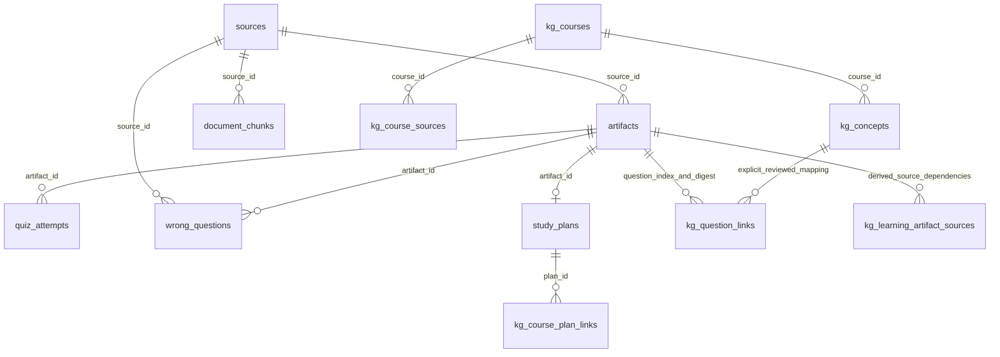
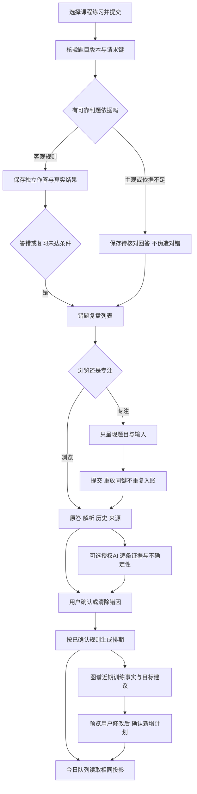

# FileMate 错题复盘 2.0：A级现状审计与待确认设计

审计取证：2026-10-25；交付核对：2026-10-26。状态：**A阶段交付候选，待用户决定；B—E尚未开始，未部署。**

## 1. 范围与事实基线

本轮只执行用户任务书的A阶段：读取、追踪、隔离合成验证和形成设计；不修改产品代码、数据库迁移、线上配置或用户数据。本文中的“拟议”均不是已有API或已上线功能。任务书SHA256为`809fee871c2664ba302c5ea42d6560a28d7b3dc2494d62697bb08ee077c64b20`。

- 实际工作目录：`C:/Users/胡希/.codex/worktrees/release-alpha3/FileMate-Project`；由`codex/knowledge-graph-2-audit`的`9f06d1d79d777e50c113908481cbdaf57fb79705`建立文档分支`codex/wrongbook-2-audit`。名义目录`D:/FileMate-Project`停在其他旧分支，不作为本轮源码。
- 当前栈：Vue 3、Vue Router、Pinia、Element Plus、Vite；FastAPI、Python、SQLite；Tauri 2桌面壳。保留现有技术栈、页面URL、模型适配层与隐私机制。
- 本轮实际HTTPS读取`/release.json`为200：API `41a360bd`、Web `4be657c6`、`1.3.0-alpha.4`、业务schema34、治理schema3；课程图谱与助手开启、面试教练/实战/评分开启，独立录音录像关闭。`/api/ready`为200，数据库、账号、治理均ready。发布标记是上轮发布信息，不等于本轮重新审计了全部生产数据库或当前持续负载。
- 上轮已证明生产SQLite3.26.0兼容；本轮仅核对发布标记并在本机隔离库审计schema34，不打开真实账号资料或生产数据库。后续迁移必须继续覆盖SQLite3.26.0，不能只凭本机新SQLite通过。
- 原有24个修改状态的测试文件保持原样，以本轮开始的逐文件SHA256核对；不纳入本轮提交。面试2.0、图谱2.0的已上线成果为受保护基线。
- 阅读依据：`README.md`、`AGENTS.md`、`filemate/docs/API_SPEC.md`、`docs/AGENT_DEVELOPMENT_EXECUTION_PLAN.md`、`design-system/filemate/MASTER.md`及下列实际源码。历史文档的schema9/24/33与“未上线”等状态不覆盖当前代码和发布回执。

## 2. 当前能力分层

| 类别 | 审计结论 | 主要依据 |
|---|---|---|
| 已有真实能力，相关回归通过 | 练习生成与持久化题集、规则判题、每次独立作答、错题收录、解析、单项错因与备注、搜索分页、连续正确/再次答错状态、到期队列、计划进度、目标按需重排、图谱显式题目关联 | `server.py`、`execution/storage.py`、`study/`、`course_graph/`、本轮144项回归 |
| 有界面但业务能力不足 | “已掌握”为现役连续两次规则；不是延迟验证。错题页的“相似度”和今日页“匹配度”实际是二值0/1。清除错因选择“还不确定”仍显示用户确认及置信度1。未发现本页现有按钮完全空接线，但不能据此认定2.0已具备 | `Wrongbook.vue`、`Today.vue`、`submit_quiz_attempt`、`update_wrong_diagnosis` |
| 后端已有，界面未完整呈现 | 分页接口支持source_id/error_cause；错题页只提供搜索、已掌握切换、到期筛选。题目答案/来源ID/排期字段存在，但错题页没有参考答案区、原文定位、排期编辑、历史独立记录或精确节点跳转 | `wrong_question_page`、`get_wrong_question`、`services/api.ts` |
| 需要新增 | 可追溯复习事件、首次/复习区分、暂停/恢复/推迟、时间与规则版本、浏览与专注模式、可信判定层级、按需AI错因、建议采纳/撤销、全量队列统计与精确深链 | 本文第6—12节，待确认 |
| 当前不能可靠声称 | 简答语义正确性、AI错因的因果判断/校准概率、长期掌握或最佳学习策略、真人学习收益、未经测量的真实耗时、代码通过即概念掌握 | 文本规则的能力边界；没有真人研究数据 |

## 3. 十步真实调用链审计

路径以下述代码位置为准；行号是本轮基线位置，后续编辑可能变化。

| 步骤 | 页面 → 调用 → 持久化 | 当前真实行为与缺口 |
|---|---|---|
| 1 选择练习 | `/ai-tools` → `LearningArtifact.vue:14`；图谱`CourseLearning.vue:10` → `kg_question_links` → `questions` Artifact | 客观选择/填空/简答三类；OJ题是另一类有编译器证据的对象，不是同一表。没有单独重复的学习错题表 |
| 2 提交回答 | `LearningArtifact.vue:53`、`Wrongbook.vue:110`、`Today.vue:190` → `services/api.ts:771` → `POST /quiz/attempts` (`server.py:3302`) | 各入口发原题JSON快照，避免旧页面对新版题目记分；图谱控制器还传request_key，另外三个旧入口没有传 |
| 3 判题 | `server.py:3331` → `study/question_validation.py:25` → `study/generator.py:210` | 校验题目及答案结构，再进行本地规则匹配，分数只有0/1；不是LLM语义评分。部分简答只验证包含参考文本，带额外错误断言也可能通过 |
| 4 错题落库 | `storage.py:1892` → `_record_quiz_attempt:1923` → `quiz_attempts` INSERT及`wrong_questions` UPSERT，同一BEGIN IMMEDIATE事务 | 错误首次创建，重复答错累加；唯一键为artifact_id/question_index。不存在独立review_tasks表。request_key相同且正文一致只返回同一attempt；不带键则每请求都是新证据 |
| 5 原题与答案 | `quiz_attempts`保存用户答案、时间、结果；`wrong_questions.question`保存原题JSON；Artifact保留题集 | 首次错误答案没有留在latest_answer，但仍在独立attempt；原题修改会冻结旧Artifact并迁移旧作答/错题到只读历史版本（`update_artifact:1583`）。暂无每条attempt的判题版本、复习模式、耗时或前后状态 |
| 6 解析与错因 | `Wrongbook.vue:32`展开本地解析；PATCH `/wrongbook/{id}/diagnosis` (`server.py:3750`) → `update_wrong_diagnosis:2184` | 现有七分类、单选和300字备注可保存。初始规则建议按题型/回答给0.35—0.55固定值，未校准；不是AI分析。用户确认的错因不会被后续规则覆盖。修改历史被覆盖，没有独立诊断事件 |
| 7 重答 | 同`POST /quiz/attempts` → 新attempt_id；仅同request_key回放复用 | 不是覆盖最初答案。错题页没有提交中互斥；今日页有按钮busy，但Enter回调没有同步拒绝已在途请求；网络超时重试旧入口也可能重复入账。错题页仅在答对后重载，答错后的错误次数/最近答案暂时陈旧 |
| 8 状态/排期 | `storage.py:1987—2079`更新streak/mastered/interval/ease/review_count/next_review_at | 首错立即到期，review_count已为1。正确后1天，再至少3天，之后按ease放大至365天封顶；两次正确即mastered=1，之后不再入今日队列。没有跨日/到期间隔资格检查。再次答错重置streak/mastered，立即到期 |
| 9 今日队列 | GET `/review/today` (`server.py:3872`) → `list_wrong_questions:2082` → `daily_coach.select_daily_queue` | 从最多50条到期且mastered=0的错题和最多20个活跃计划候选中选最多8项，并受10—240分钟预算限制。pending_wrong_count是截断候选长度，deferred_count只统计候选，非全库。错题项含原题快照但页面未呈现选择题选项；完整复盘只跳`/wrongbook`，没有定位题目 |
| 10 统计/计划/成长 | `/analytics/overview` → `get_learning_analytics:3220`；`goal_planner.py:53`；`portfolio/growth.py:41`；图谱`learning_evidence.py:38` | 基于实际记录。完成计划日只改completed_days，不能生成答对。目标根据聚合统计与重点错题按用户点击重排，不会随一次重答自动完成目标。聚合“未掌握”、今日“已到期”与图谱“有验证映射的近期表现”分母不同，应分别命名并说明 |

补充：`study/scheduling.py`的1/3/7/15/30天纯函数被导出且有单测，但检索当前产品调用方未发现它被`POST /quiz/attempts`或今日队列使用；不能将其文档当成现役排期。现役算法在storage内。

### 3.1 状态保存在何处

**服务端持久化：**题目、每次答案/结果、错题聚合与排期、错因/备注、今日预算/手动顺序、计划完成日、目标Artifact、图谱题目映射。刷新、登录或重启不应删除这些记录；相关重开库/持久化回归已执行。

**仅本页内存：**`Wrongbook.vue`的answers/results/expanded/causeDrafts/noteDrafts；`Today.vue`的answers/results/working；`LearningArtifact.vue`的本轮题号/答案表单/结果标记。离开或刷新后未提交草稿、结果展开与选择位置不保留；已提交attempt仍保留。2.0必须明确区分“草稿未保存”和“作答已保存”，不许悄悄把未提交输入当成绩。

## 4. 数据关系与来源边界



实体说明：

- `quiz_attempts`：attempt_id、artifact_id/source_id FK、question_index、user_answer、is_correct(非空)、score(非空)、feedback、created_at。题目身份为Artifact版本＋索引；同秒记录可通过rowid排序。
- `wrong_questions`：wrong_id；题目身份唯一；question JSON、latest_answer、error_count、correct_streak、mastered；v8排期next_review_at/interval_days/ease_factor/review_count；v16 knowledge_key/label及诊断字段。FK删除题集/来源会级联清除对应错题和作答，这是已有“彻底删除”的语义，不改成静默保留。
- `study_plans`：独立计划实体，completed_days为日任务执行记录。今日队列是只读投影，没有额外创建一套任务表；偏好存独立现有偏好数据。
- 目标反推：`reverse_goal_plan`类型Artifact；关联source_id，可选真实focus_wrong_id及attempt/source/question/diagnosis修订。`server.py:2920—3126`验证旧证据失效；本专项不得破坏面试口述训练回路。
- 旧`knowledge_key`按来源与标签派生，**不是**课程图谱2.0的concept_id。`kg_question_links`绑定course_id/concept_id/artifact_id/question_index/question_digest；课程内融合映射、解除和来源停用都要由现有投影解释，不能仅按同名自动合并或跨课程累计。
- 新图谱来源定位：现有`GET /api/knowledge-graph/courses/{cid}/concepts/{nid}/source-evidence/{eid}`；`bounded_quotes`逐字核验来源修订与字符范围。没有证据的旧题可尝试现有检索但必须标“检索候选”，不可补造页码或声称已审核。
- 当前缺失：错题级事件/排期操作日志、作答复习类型、规则版本、状态前后快照、暂停/推迟状态、多错因、已阅读解析记录和AI诊断Artifact。不是数据库损坏，而是2.0尚无这些模型。

## 5. 问题与风险账本

P1表示在本专项发布前必须解决的证据或流程问题，不表示本轮发现了全站P0或已经完成全面安全审计。

| ID/优先级 | 事实与复现 | 2.0处理原则 |
|---|---|---|
| WB-01/P1 | 合成首错后，同一秒连续两次正确即mastered=1；首次错误计为review_count=1；mastered题即使有将来的next_review_at也不再被队列选取 | 首次/重练/到期验证分开；历史规则保留标签；新规则有版本与资格，不宣称长期掌握 |
| WB-02/P1 | 同键重复提交只有1条；无键同题同答案两次产生2条。Wrongbook/Today/LearningArtifact旧入口不传键 | 全入口共用同一提交协调器；同次操作同键，输入/题目版本改变才新键；事务、HTTP与刷新恢复共同测试 |
| WB-03/P1 | 55道到期题→错题分页total55，今日pending50、选中6、deferred44 | 服务端全量计数、独立候选分页/预算结果；“总待复习/到期/已排入/未排入”清晰区分 |
| WB-04/P1 | 简答包含参考句及额外错误断言仍可被规则判对；旧界面称分数为相似度/匹配度，实际0或1 | 显示判定方式/适用范围；不可靠语义结果不能升级可信状态；不以AI猜测填补确定判题 |
| WB-05/P1 | POST accepts empty answer as错误并写库；5000字符回答也可写库；QuizAttemptRequest未声明题目索引下界/回答长度 | 2.0新增明确“不会/跳过”动作，不用空提交隐含区分；服务端长度/范围/请求结构上限，不只前端禁用 |
| WB-06/P2 | “还不确定”保存后source=user/confidence=1；原规则0.35—0.55是常量 | 不显示校准概率；明确用户选择“未确定”，诊断修改/清除可追溯 |
| WB-07/P2 | 错题页无独立历史/原文/节点/排期操作；源与错因后端筛选未接；图谱/今日跳全表；解析字段仅explanation，analysis格式题可能没有解析按钮 | 统一详情归一化与精确深链；支持legacy analysis/explanation；无来源显式空态 |
| WB-08/P2 | 30张完整错题卡重复表单；题干17px、重答单行；草稿离开丢失；答错后聚合未刷新 | 列表＋单题阅读工作区，长答案textarea/代码区；草稿保护和异步失效控制 |
| WB-09/P2 | 没有暂停/恢复/推迟/可解释操作历史；已掌握页不能重答 | 增量排期状态与操作事件；手动变更先预览，重放不叠加，允许逆操作 |
| WB-10/P2 | 旧聚合/成长/目标和新图谱的证据筛选规则不同 | 统一可信度字段与投影入口；历史报告保留当时快照，生成新报告时标规则/分母 |
| WB-11/依赖 | 上轮万节点2s热请求门限与浏览器3s门限未全通过；本轮未复测整个图谱性能 | 不把本专项通过当作关闭上轮性能、无障碍、设备或真人研究遗留 |

5组合成探针是“现状特征验证通过”，**不是上述缺陷已修复**。记录见[验证证据](../../audits/wrongbook-2-a-2026-10-25/verification.json)。

## 6. 用户场景与目标流程（拟议）

大学生从课程练习发现问题；需要先独立回忆，再核对原答/依据，确认可能错因，安排可执行的下一次复习。复习不是打开解析或点击完成；AI是可拒绝的建议工具。



不自动覆盖已有学期目标、不把一次错答扩散成全课能力判断、不将查看解析当答对；用户可提前练、暂停、改期或拒绝AI建议。

## 7. 页面草案（拟议，非已开发界面）

延用当前可选主题与原无衬线字体，不新增宋体/艺术字、金黄块、远程字体或图标依赖；用本地Tabler SVG。保留统一侧栏和`/wrongbook`，不再在顶部复制功能导航。下面不填虚构统计，概览均为数据库投影。

```text
桌面：全局侧栏保持原样；本页内容区
┌ 错题复盘                       [开始本次复习] ┐
│ 今日到期 · 逾期 · 待核对 · 达到复习标准（真实数）│
│ 搜索题目／资料   [课程范围] [筛选] [清除]       │
├ 题目目录约28% ─┬ 单题阅读/作答约72% ───────────┤
│ 状态＋题目摘要 │ 课程与题型＋当前复习状态       │
│ 来源／下次安排 │ 24px题干；选择项/长文本/代码区  │
│ 当前项高亮     │ 原答 ⇄ 本次回答（提交后核对）  │
│ 分页与总数     │ [先独立作答]／[核对答案]       │
│               │ 解析、错因与下次复习           │
│               │ 来源／图谱／历史：按需展开     │
│               │ [AI分析这次回答] 单独授权      │
└───────────────┴──────────────────────────────┘
专注模式：当前题与进度 → 独立回答 → 提交结果 → 下一题
手机/窄窗：概览 → 列表；点题进详情，返回保留筛选和滚动
```

视觉与交互约束：

- 正文18px、问题24px起、辅助15—16px、主操作17—18px；44px以上触控区；深浅四主题使用现有语义令牌，正常正文对比度至少4.5:1作为验收目标。
- 不另做30套完整卡片/表单；列表只摘要，主区给长题/公式/代码横向滚动与换行空间；公式不执行用户HTML，内容渲染延用安全边界。
- 来源、历史、AI分段按需打开；来源未找到、历史题只读、图谱未关联、无结果、损坏记录都使用真实状态。不得把缺失关联用同名节点补齐。
- 专注时答案/解析默认收起；主动查看后记录为“看过答案的练习”，不能算本次独立验证。答案可能已通过旧API下发，本模式是学习交互而非防作弊考试；若需要防抓包题目接口，应另设不含答案的服务端DTO。
- 一次复习批次默认10道、最多20道（工程建议，非用户已确认），按当前筛选生成稳定题目版本快照；不预先标完成，关页保留已提交进度，未交答案先提示。
- 同一条回复只允许一个提交中状态；切换题目、身份、来源删除或备份恢复后丢弃旧响应；网络不确定时保留输入与同键，409刷新题目但不丢原稿。
- 按题目ID深链`/wrongbook?focus=...`，可带course/status/q；详情不存在/不属于当前空间显示404状态，不悄悄跳到第一题。筛选与返回位置写URL/会话偏好，回答正文不放URL。
- 分页默认30，不对全库错题一次性渲染；1万条服务端搜索/统计和长文本必须验收。视觉不能代替实际浏览器、键盘与窄屏检查。

技能实际使用：读取UI/UX Pro Max与frontend-design；运行本地`search.py`的`ux`和`vue`检索。采纳焦点、错误播报、对比度与渐进展示建议；不因检索建议盲目新增VeeValidate、替换现有Pinia或重建全局主题。A级没有编写或运行新前端。

## 8. 复习状态与排期候选（待Q1/Q5）

### 8.1 两个候选

| 候选 | 规则 | 优点 | 代价 |
|---|---|---|---|
| 兼容优先 | 保留现役ease/1天/至少3天规则与连续两次；文案改“已完成两次复练”，不称长期掌握 | 改动较小，历史含义稳定 | 短时记忆/重复提交即升级的问题不能仅靠文案解决；需要独立作答资格和幂等保障 |
| 推荐：透明分级 | 到期验证阶段间隔1/3/7/15/30天；至少3次合格独立正确、分属3个上海日期、首末跨度≥7天，才标“达到本轮复习标准” | 每次有依据与版本，可解释和测试 | 更严格，需数日才能达标；这是产品规则，不是验证过的最佳记忆算法 |

推荐方案的完整提案：首错现在待处理；独立纠正且可可靠核对后进入“待复习”，下一次1天；到期验证正确才推进到3/7/15/30天，满级维持30天滚动，出错重回待复习并缩短为1天（同次错题不在刷新后无限重复投递；可主动继续练）。当场纠正不计入三次延迟验证；例如第0天纠正、第1/4/11天分别到期验证正确，到第11天满足三次、三日期及至少7天跨度。中途再错则重新起算合格验证序列，完整历史仍保留。提前练可保存但不推进阶段、不反复顺延既定到期。到期时间存UTC有偏移，分日资格用Asia/Shanghai；“今日到期”=当前已到期，“今日稍后”单独展示，不混称。老无时区时间明确按旧库UTC解释，无效/未来时间展示异常待修复，不能偷偷判作答对。

### 8.2 状态分成两个轴

`learning_status`：new（新收录）/needs_review（待复习）/provisional（已纠正待间隔验证）/criterion_met（达到本轮规则）/pending_check（依据不足待核对）。

`schedule_status`：active/paused；本次review_session的in_progress是会话状态，不覆盖题目的长期状态。另保留`legacy_mastered`标签表示旧“两次正确”结果。

| 操作/证据 | 状态影响 |
|---|---|
| 查看原文/解析/AI结果 | 只记录查看；不增加正确次数、不推进阶段 |
| 首次真实错误 | 新收录＋立即待处理；首次不是“复习1次” |
| 可靠独立纠正 | provisional；按规则安排下一次，不能直接掌握 |
| 合格到期独立正确 | 累计合格证据；满足次数/日期/跨度才criterion_met |
| 再错 | 保留历史，退出criterion_met/provisional，缩短排期 |
| 主观自查或AI辅助 | pending_check或自述复习结果；可安排下次，但不算确定正确与达标 |
| 暂停 | 记录原排期/理由，从自动队列排除；基础回看可用 |
| 恢复 | 预览有效新排期后确认；不凭恢复动作升级训练表现 |
| 提前/推迟 | 绑定当前修订，保存操作及前后时间；不增加作答或完成次数 |
| 撤销排期变更 | 只逆转相应操作；若已有后续作答则409，重新预览；不删除真实作答 |

旧mastered=1不直接改判失败或批量塞回今日队列；显示“历史两次复练规则”，用户主动选择后启用2.0再验证。旧未掌握保留到期时间，后续有效作答开始使用已确认版本；不从旧review_count反推不存在的独立复习次数。

## 9. 数据/API增量方案（提案，不是迁移计划）

优先复用`quiz_attempts`/`wrong_questions`/`study_plans`和原有预览审计。追加版本从实际schema34之后分配，不能修改v1—v34或占用其他卡迁移；具体DDL在B开始前依据已确认规则固化。

- `quiz_attempts`拟补：purpose(first_practice/review/early_practice)、judgement_method、judgement_status、rule_version、question_digest、review_session_id、answer_revealed、duration_ms可空、duration_source。状态前后及schedule_eligible通过关联复习事件追溯。
- **未可靠判定答案的数据约束必须解决：**当前is_correct/score均NOT NULL。推荐追加迁移允许待核对回答使用NULL，并要求judgement_status=pending/self_reported时不进入确定正确率、错误次数或达标投影；历史0/1原值原义保留，所有消费者显式按可信状态过滤。若无法在B覆盖全部消费者，则先仅开放原有客观题的2.0状态推进，主观题保持原回看且清楚标边界；不能用false/0占位伪造失败。最终采用哪项受Q5确认与B实现计划约束。
- `wrong_questions`拟补：学习/排期状态、scheduler_version、revision、暂停时间、阶段与原排期；保留mastered供兼容读取，但统一派生逻辑，不能两套排期同时写。
- 拟增轻量`review_events`：唯一event/request ID、wrong_id、可空attempt_id、动作、前后状态/时间、规则版本、操作者、created_at；不复制一套题目/用户画像。错因编辑、清除与排期动作留可解释事件，记录必要ID与枚举，普通日志不含答案/密钥。
- 多错因拟用固定原因代码＋可选主因＋最多3项/自定义标签，保留旧主因映射；自定义不改变历史语义，删除标签不删作答。分类修改须新修订，旧AI分析标过期。
- `review_sessions`拟保存有界批次、题目版本、当前题及已提交attempt IDs，取消不撤销真实作答；过期会话不自动完成。默认不持久化未提交答案，若未来加草稿应另有清除/隐私策略。
- AI结果作为Artifact（拟议类型wrong_review_analysis）及运行元数据保存，事件绑定wrong/attempt/题目/资料修订、Provider/model、prompt版本、证据摘要、有效/过期/失败状态。因为旧错题未必属于课程，**不能**只扩展kg_learning_work后要求所有错题伪造course_id；可抽取通用运行协议，但不建第二套模型配额账本。

拟议接口，发布前同步`API_SPEC.md`与调用方，**本轮不向公共规范写成已存在**：

| 提案 | 目的及边界 |
|---|---|
| GET `/wrongbook/summary` | 同一只读快照中的全量状态/到期/逾期计数、计数口径和规则版本 |
| GET `/wrongbook/{id}`、`.../attempts`、`.../events` | 当前用户详细题目/最近答错与最近作答/分页历史；固定路径优先于{id}，避免page/summary被捕获 |
| 扩展GET `/wrongbook/page` | 课程显式映射、来源、状态、原因、错误次数、时间、排序；先全库过滤再分页，稳定ID收尾 |
| 协调现有POST `/quiz/attempts`或新增版本化复习提交入口 | 共用一套落库事务；原题快照与同操作请求键；旧合同保留，未核对结果不得偷塞到旧0/1字段 |
| POST `/wrongbook/review-sessions`及会话GET/提交 | 批次、恢复、跳过、已查看答案标记与完整去重；不凭开始动作增加次数 |
| POST `/wrongbook/{id}/schedule-preview`、`.../schedule-confirm` | 暂停/恢复/改期；确认token绑定版本、操作与参数；幂等、审计、反向预览 |
| PATCH `/wrongbook/{id}/diagnosis`扩展或版本化 | 多因/主因/清除、expected_revision、防丢更新、事件；旧单因调用保持可读 |
| POST `/wrongbook/{id}/analyses`及分析GET/取消 | 明确授权、输入版本、有限调用、缓存、失败恢复；不自动改错因或计划 |
| POST 建议/目标增量预览与确认 | 只新增选中任务，有限数量，说明依据；不让旧`replan`直接覆盖所有任务来冒充可控采纳 |

## 10. AI分析与证据契约（D阶段，待Q3）

当前错题规则建议不调用模型。可复用`LLMClient`、`BaseLLMProvider`、OpenAI兼容适配器、`call_structured`离线JSON Schema验证、全局治理限额与脱敏异常；不是重新接一套DeepSeek客户端。服务端Provider可配置，浏览器自带密钥仍只临时发往现役受信端点；新路由必须显式加入精确允许列表及前端授权，不放宽为任意URL。

推荐手动按题/按次点击：展示将发送题目、选中作答、最多最近5条相关历史、已确认错因、已审核概念与最多3段总计6000字的实际引用；不发整本资料、录像、简历或其他课程。单次1次模型调用、20秒总期限、同错题1个在途；不隐式纠正重调，失败后用户主动重试。仍受现有空间/全站治理预算与并发限制；HTTP无响应不能更换请求键绕过去重。

输出结构候选：possible_causes[]（cause_code/hypothesis/answer_evidence_refs/source_evidence_refs）、uncertainties[]、smallest_action、targeted_practice_suggestion、schedule_suggestion及reasons；不返回自创掌握率/心理原因百分比。答案证据需要可核对的attempt_id＋原文子串，资料引用只接受服务端白名单ID/修订/字符范围。缺证据可返回无法确定；结构或引用校验失败就是failed，不能存成功内容或覆盖旧结果。引用合格也不证明语义真因已验证。

缓存键覆盖question_digest、选中attempt/历史摘要、错因版本、source修订、规则版本、prompt版本、provider/model；同输入默认读最近有效结果，用户要求重新分析才创建新运行；输入变化标过期，旧分析留历史但不推荐为当前结论。源删除级联清除派生正文与必要引用，恢复备份使在途运行中断并作废预览/授权，配额不回滚。

AI候选错因需逐项用户采纳，写入user来源及原分析引用；计划建议必须先预览，可编辑/取消/确认新增/撤销。GET列表、详情、图谱和今日读取不得自动调用模型。失败、断网、预算满、Provider切换都不影响基础查看、错因编辑和客观复习。

## 11. 与图谱、今日、目标和成长联动

1. **图谱：**反查显式有效kg_question_links，显示课程与concept；复用融合root解析与source-evidence；题目修订失效映射不能跨版本继承。保留图谱`course-training-v1`语义（近7天错答/到期覆盖；近30天3道不同题且跨2天稳定），错题“达复习标准”是另一对象的规则，不让一个覆盖另一个。引入可信判定后两投影都要过滤未核对证据，且保留版本说明。跨课只导航。
2. **今日：**仍是统一投影，不为错题页面自建任务池。全量统计与有界候选分开；paused排除、改期即时反映、session完成只认实际attempt；错题页与今日页调用同一服务。需要响应式重取/主动刷新，跨页回到前台可刷新；不声称无推送也有实时同步。计划勾选仍只是任务完成。
3. **目标：**同资料/课程范围读取反复错答、逾期与用户确认错因；显示分母、时间窗、实例ID及规则版本。一次错误只建议短行动；用户点击采纳增量才新增任务，最大7项；不修改学期目标与原计划。旧目标快照/无效证据回路保留，已完成任务不得悄悄重置。
4. **成长/技能：**练习次数与复习次数分开；正确率只统计可确定结果并显示方法/分母；待核对、查看解析、自评不补作正确。更新evidence_profile、growth、skills及相关页面口径。旧报告保存生成时语义，重算新报告才用新规则，不能伪装成历史效果改善。
5. **编程边界（Q7）：**OJ原始提交/代码/测试点/编译器结果留在`coding_submissions`和事件；首批可提供带submission_id的入口与对照，不能把C++编译失败自动当课程概念错答，不能拿AI建议代码冒充AC。如纳入统一排期，需单列typed coding evidence与验收卡，不能隐式复用artifact题号或扩大本B卡。

## 12. 迁移、隐私与回滚

迁移前备份及独立恢复；使用现有版本迁移，失败事务回滚；v34旧库、已迁移空库、有历史题集/孤立异常记录库均要验证。新增索引围绕wrong_id/attempt_id、状态到期、来源/显式课程关联、request_key唯一；不为每个筛选盲目建索引，万级查询用实际执行计划与数据测试。

新增未判定状态会影响非空列约束、导入顺序、旧备份、统计、图谱、目标与成长，是B的首要设计风险；若需要重建SQLite表，只能在追加迁移中保留每行ID、原值、索引、外键与引用，并有故障注入证明。禁止未经验证先上线NULL数据再等以后修消费者。

隐私：来源/题集彻底删除沿用已确认级联及审计；新增分析依赖所有实际引用来源，删一来源不能残留敏感正文；暂停不是删除、移出课程不是彻底删除。个人导出/签名恢复与管理员备份要包含新表；所有新运行的配额在独立治理库，不通过旧备份返还。新事件仅存必要证据，导出/删除覆盖，已下载副本与第三方保留边界说明。

拟议独立`FILEMATE_ENABLE_WRONGBOOK_V2`/`VITE_ENABLE_WRONGBOOK_V2`默认关闭，**当前尚不存在**。关闭新写入不屏蔽旧证据读取/导出/删除。回滚推荐保留兼容新schema的后端并关闭新入口，不能把旧升级快照覆盖上线后新作答，也不承诺直接降级到不认识新状态的旧二进制。E需演练关闭、旧数据读写、已写新数据读取及备份恢复。

## 13. 阶段顺序、准备修改的模块和验收

本轮只新增本文和A级验证证据、文档索引，不动产品代码。以下为B—E建议，不是实施授权或已经完成：

| 阶段 | 目标与预计范围 | 退出条件 |
|---|---|---|
| B | `execution/storage.py`追加迁移与事务协调；拟议`study/review_*.py`；server/API/types；所有attempt消费者、个人备份/恢复/删除与治理边界 | A关键问题已确认；DDL/未核对证据兼容方案先固定；状态、间隔、幂等、并发、迁移、隔离和故障回滚定向测试通过，旧面试/图谱回归通过 |
| C | `Wrongbook.vue`拆成列表/详情/专注；共享提交协调器接LearningArtifact/Today；services/types、navigation/deep-link | 真按钮真数据、原稿/状态恢复、空错加载、长文本/代码、375/768/1280/1440宽度、键盘与焦点检查；不宣称D已接 |
| D | 按需结构化AI、分析Artifact与运行/来源依赖；显式图谱深链；今日同源投影；目标只新增任务 | 超时/无密钥/429/无引用/坏JSON/陈旧来源失败可恢复，基础不依赖LLM；建议必须确认；原始证据不被覆盖 |
| E | 后端/前端/浏览器端到端、生产SQLite、性能/备份/回滚与交付 | 十个任务书场景逐项实测；未执行/失败保留。发布另行申请或按届时明确授权执行，不因A获批自动上线 |

每阶段结束停下，报告实现/测试/遗留/下阶段；用户明确确认后才继续。若Q5或Q7扩大范围，先更新相应设计与任务卡，不能跨卡重构。

验收矩阵：

| 类别 | 必须覆盖 |
|---|---|
| 证据 | 首错原答保留、每次重答独立；同秒正确、提前练、到期练、看过答案、自评/模型/规则分层；无记录不推断 |
| 排期 | 首错/纠正/多次正确/再错、暂停恢复改期、重复确认/撤销、闰日/跨上海日/UTC偏移/旧无时区/非法时间、注入时钟 |
| 一致性 | 双击/Enter、超时后回放、跨连接并发、题目修订/删除/身份切换/恢复时在途请求；Today/Wrongbook/Graph/Goals口径可解释 |
| 数据 | v34→新版本、老个人备份、FK/integrity、失败回滚、全部引用源删除、旧题集只读、配额不可重置 |
| API/AI | 所有权、严格参数边界、分页/排序/筛选、敏感错误脱敏、缓存版本、明确授权、有限调用、断网/坏JSON/虚构引用/Provider失败 |
| UI | 全部加载/空/无匹配/成功/错误/超长文本状态；答案默认隐藏、选择题选项、长文件名、代码区、刷新/返回、可访问键盘操作 |
| 规模 | 100/1000/10000错题与相应历史，首屏有界，搜索/筛选先分页；记录数据规模/冷热/并发/延迟，不把正确性通过等同容量SLA |
| 完整流程 | 错题形成→原答/解析/来源→确认错因→新作答→正确排期→再错保历史→今日同步→真实节点→AI故障仍复习→刷新重登重启→旧库迁移 |

## 14. 本轮实际验证与未执行

在原产品快照、不修改业务代码条件下：

- 7个现有测试文件：**144 passed、1 skipped、1 warning，52.11秒，exit0**。包含万条错题分页、服务持久化、目标反推、图谱学习与本机运行时兼容。跳过为Windows符号链接权限；warning为Starlette现有httpx弃用提示。
- 两个现有前端测试文件：**13 passed，exit0**，覆盖图谱提交键、失败恢复与练习组件；不是错题新界面验收。
- 本轮只读审计脚本5组：**5 passed、1同类warning，4.34秒**；均临时合成库，quick_check=ok、FK违规0。探针所称“通过”是成功证明当前行为/缺口。
- 公网只读发布标记及正确就绪路由200；**没有**生产写入、账号测试、真实LLM调用或本轮部署。
- 首轮测试命令因审计临时父目录未创建导致145个setup error，未进入业务；创建该父目录、使用新隔离目录后上述144项通过。原日志保留。首次误探`/api/health/ready`404；源码合同实际是`/api/ready`，正确路由200。不把错误探测路径视为网站故障。
- 这是文档/审计任务，按风险运行上述定向验证；未重跑约20分钟的全量`verify.ps1`，未重建前端、未进行本轮实际浏览器/实体设备/万节点容量或真人学习实验，不能继承上轮通过数当成本轮结果。

证据目录：`docs/audits/wrongbook-2-a-2026-10-25/`；可复现原脚本、完整临时日志及合成数据库位于忽略的`_working/wrongbook-a-20261025/`，不提交数据库。只归档脱敏结构、汇总及合成观察。

## 15. 需要用户决定的问题（每项均未默认批准）

1. **复习规则：**推荐新题采用透明1/3/7/15/30天，至少3个不同日期的合格独立正确且跨7天才“达到本轮复习标准”；旧“两次正确”保留历史标签、不会自动改判或塞回队列。可选择保留原规则并降低文案承诺。推荐理由：避免同秒连答被当长期掌握，用户能理解每次状态变化。
2. **错因分类：**推荐保留原七类并补方法选择/条件理解/计算/代码/边界/时间压力/其他；一个可选主因、最多3项及可选自定义标签，允许清除。AI只是候选，用户确认后落库。推荐理由：兼容原数据、能表达复合原因、不过度增加填表成本。
3. **AI触发与费用：**推荐仅主动点击单题分析，逐次展示外发范围并授权；1次调用/20秒、同题单运行，同输入读缓存，失败保留复习。推荐理由：费用与隐私可控，打开列表不触发调用。
4. **复习方式：**推荐默认浏览复盘＋可选专注批次（默认10、最多20题）；先答后核对，早练/看过答案留记录但不推进独立验证。推荐理由：复盘与回忆不互相干扰；不额外开发第三套“快速模式”。
5. **主观题与学习联动：**推荐客观可靠结果才推进确定状态；主观题保留待核对/自查/模型辅助，分别统计，不伪造0/1。今日同源更新；目标只出有依据的增量预览、确认才新增，绝不自动改学期目标。推荐理由：保护证据真实性；B必须同步所有消费者与迁移，不能只改UI。
6. **页面改动幅度：**推荐重组当前错题页为“目录＋单题工作区＋按需证据”，沿用主题、字体、导航；手机列表/详情分步，补题目深链，不重做全站。推荐理由：解决多卡片、小字和重复操作，同时保护已有视觉与业务。
7. **编程错题范围：**推荐本轮先完成课程题完整闭环，给OJ错题真实入口与证据跳转；统一OJ复习排期另列后续卡。可选择本专项同时纳入，但需在B前扩大typed evidence设计与E验收。推荐理由：编译器结果和课程规则判题不能混成同一分数/题号系统。

用户可直接确认以上推荐，也可逐项改。**A级交付后停止；没有明确确认，不启动B迁移、代码重构或上线。**
