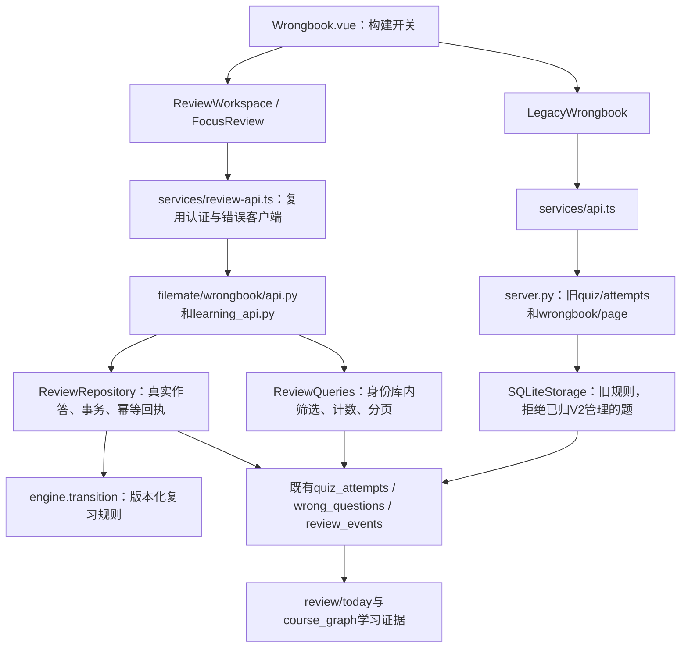
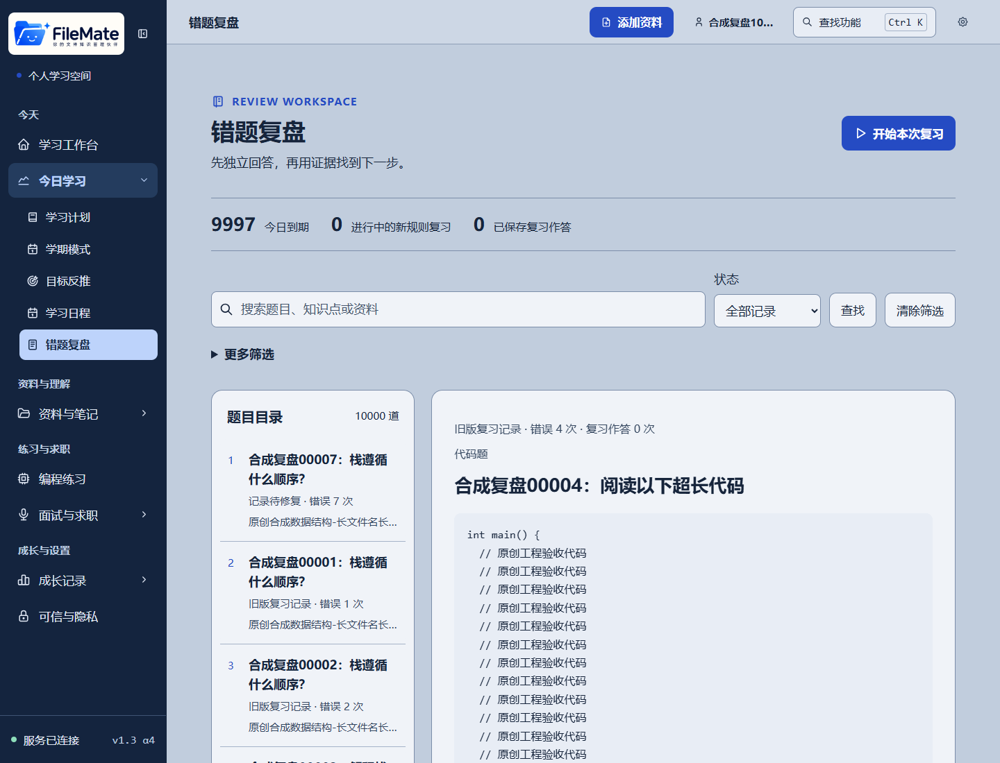
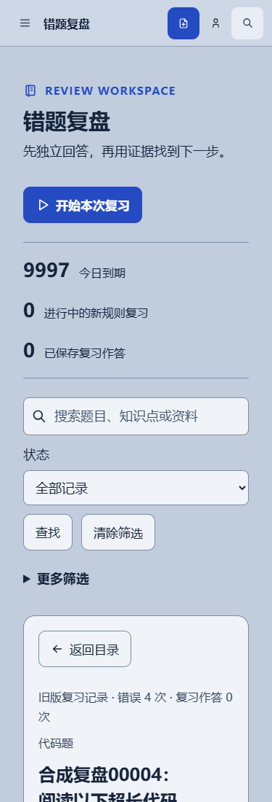

# 错题复盘增量包：A级差异审计

2026-10-29。本次依据用户提供的 `FileMate_WrongReview_2_0_增量源代码与Codex提示词.zip`（下载文件名为URL编码形式）开展A级审计。包内明确规定“立刻只进行A级”，因此本次不把候选代码安装到产品，不实施B—E，不合并或部署。此限制来自本次开发文件，不是把此前已完成的A—E重新归零。

## 1. 基线、来源与边界

- 审计工作区：`C:/Users/胡希/.codex/worktrees/release-alpha3/FileMate-Project`；现有附属工作树可复用，无需在旧的D盘主检出重做开发。
- 审计开始分支：`codex/wrongbook-2-audit`，HEAD `8a655bf23a4a56886a5d2fde2526e766cb485ac8`。本报告之后的文档提交不改变这份产品代码基线。
- 远端main实查为 `9f06d1d79d777e50c113908481cbdaf57fb79705`，本地领先37个提交，没有main领先的提交。包内描述以main为基础，不能覆盖本地已实现的新状态机。
- main最新CI成功：[运行40115768623](https://github.com/cooooooosdas/Filemate/actions/runs/40115768623)。本地分支的CI运行和PR查询均为空，不能将main绿灯当成本地37个提交的CI结果。
- 本机验证Python为3.12.13，项目声明`>=3.10`，现有CI配置3.11；这三者不是同一个兼容性范围。
- 原有24份测试存在工作树修改，逐字节摘要与上轮保存值相同；本次不将它们加入提交。
- 源码末项业务迁移36，35为复习证据、36为分析及联动。未打开生产数据库；“源码目标版本”不等于本轮查证了线上实际数据库版本。
- V2前后端和AI均保持现有默认关闭配置：`FILEMATE_ENABLE_WRONGBOOK_V2=0`、`VITE_ENABLE_WRONGBOOK_V2=false`、`FILEMATE_ENABLE_WRONGBOOK_AI=0`。本轮不读取真实密钥、不修改运行配置。
- 压缩包SHA256：`b793b52ed581e9a60f6fa40113e34b59c650725baeb50f8b2bd4d12ca7d2e4a6`。只在项目 `_working/review2-incremental-a-20261029/candidate/` 隔离读取五个文件，未覆盖任何同名产品文件。

现役产品仍以[上轮E级交付](../../WRONGBOOK_2_0_E_DELIVERY.md)为准，结论CONDITIONAL。新增候选包不改变原有验收结论，也不构成已发布功能。

## 2. 两条现役调用链

请求身份由 `server.py::_StorageRouter.__getattr__` 根据 `_tenant_context` 选择对应SQLiteStorage；V2路由经 `create_router(lambda: _storage)` 复用。新增聚合不能直接读默认本地库，也不能信任前端传来的用户ID。

旧链 `submitQuizAttempt → server.submit_quiz_attempt → SQLiteStorage.record_quiz_attempt/_record_quiz_attempt` 仍在。新链 `submitReviewAnswer → /wrongbook/v2/attempts → ReviewRepository.submit → engine.transition` 才支持独立作答、待核对NULL与新规则。旧写入遇到V2归属或已变更revision会409，禁止失败后悄悄回退到旧算法。

## 3. 当前实现矩阵

| 检查项 | 当前状态 | 源码、函数与实际边界 |
|---|---|---|
| 页面和入口 | 已实现 | `views/Wrongbook.vue`；`ReviewWorkspace.vue`、`FocusReview.vue`、`LegacyWrongbook.vue`，按现有开关选择，保留深链 |
| 全范围筛选与分页 | 已实现 | `wrongbook/queries.py::ReviewFilter/page/_where`；先筛选再分页，默认30，支持来源、课程、错因、时间、次数、状态，排序为due/updated/errors/created |
| 旧查询错因过滤 | 后端已实现，旧调用方部分开放 | `server.wrongbook_page`支持error_cause；旧`getWrongbookPage`签名和页面未暴露该参数；V2已有cause筛选，不应因此重做接口 |
| 概览 | 已实现全库聚合 | `ReviewRepository.summary`及`GET /wrongbook/v2/summary`，有as_of、rule_version、day_zone；当前摘要独立于列表筛选，不能称“当前筛选统计” |
| 原答、题目版本和历史 | 已实现 | `ReviewRepository.submit/history`、迁移35；每次保存attempt、question_digest、判定方式与审计事件；题集修订后旧快照只读，不假定可还原任意被彻底删除的数据 |
| 幂等、冲突和未知响应 | 已实现 | `review_events.request_key`与回执、预检、revision；前端`wrongbook/submission.ts`保留未知请求键，重载先查回执，不另造重复作答 |
| 错因确认与人工优先 | 已实现 | `ReviewRepository.diagnose`、`learning_commands.confirm_adoption`；人工确认保留，模型只能预览后采纳 |
| 时间与复习规则 | 已实现且分版本 | `engine.transition/parse_time`、`ReviewRepository.due_page/summary`；上海日期、服务端时钟、提前/看过答案/待核对的练习不充当达标证据 |
| 排期调整 | 已实现 | `commands.py::ReviewCommands`、schedule-preview/confirm；暂停、恢复、改期、激活新规则、撤销，均有预览、版本及幂等 |
| 今日学习与目标 | 已实现联动，非全库最优排序保证 | `server.today_review → due_page(limit=50) → daily_coach.wrong_review_guidance/select_daily_queue`；完整到期计数另聚合，候选数量有限，先尊重用户排序 |
| 图谱联系 | 已实现 | `learning_context.py`、connections路由、`course_graph/question_links.py`和`learning_evidence.py`，精确题目版本/课程/节点，不按同名补关联 |
| 按需AI | 已实现 | `analysis.py::analyze`、`analysis_models.validate_output`；Provider适配、授权、结构/原句校验、失败持久化；不把失败写成成功或替代规则判题 |
| 删除、移出课程、恢复 | 已实现边界，生产恢复仍待实机 | `wrongbook/privacy.py::source_impact/normalize_restored_wrongbook`、`execution/data_actions.py`；彻底删除清理依赖，移出课程与彻底删除分开，恢复使旧预览/分析代次失效 |
| 阅读位置及模式切换 | 已实现，仍有可优化空间 | `browse-state.ts`保存筛选与实际滚动容器位置；`focus-state.ts`保存批次引用，不通过打开解析增加“掌握”计数 |
| 题型 | 部分自动核对 | 选择/填空按客观规则；主观/代码文本保留原答并待核对。独立C++ OJ不是此页面的自动评分器，不能拼出假确定分数 |
| 新样例推荐排序 | 未接入 | 现役页无priority排序选项，不能将包内纯函数当成已上线服务；今日队列已有另一套带原因规则 |
| 新样例按分钟挑题 | 未接入 | 已有专注批次1—20题和D阶段最多7项计划预览，尚没有将本次时间预算接入专注批次的正式合同 |
| 研究效果与全量发布 | 未验证 | 合成回归不证明真实学习效果；E-P2-01和生产Linux恢复/容量依赖保持开放 |

## 4. 字段与规则口径

- `quiz_attempts`是每次真实作答证据；`wrong_questions`是题目复习状态聚合；`review_events`是命令和回执审计，不建立平行状态库。
- `error_count`：V2在独立客观核对错误时增加；自报、不确定判题不能冒充新的确定错答。`review_count`保留聚合兼容语义，`review_attempt_count`区分复习回合；统计须读取对应字段或可信attempt，不能相加充当练习人数。
- `correct_streak`不等于掌握。旧规则保留连续两次答对的原义；V2达到本轮标准还需合格的延迟验证次数与时间跨度。`criterion_met`之后仍会有下次到期复习。
- `interval_days/next_review_at/review_stage`由对应版本规则维护；旧`ease_factor`属于旧规则，不能拿它反推V2能力。暂停是独立状态，不应被新排序绕过。
- `error_cause_source`区分rule/user/unconfirmed。旧 `_suggest_error_cause`按启发式给0.55/0.45/0.4/0.35；人工确认写1表示确认来源，不是统计校准后的概率，也不是模型准确率。
- `filemate/study/scheduling.py`仍存在阶段纯函数，但全仓调用检索只见定义/导出，未发现现役服务写入链使用它。实际旧SM式间隔在storage，新规则在engine；存在多种版本规则，不意味着应把它们强制合并。防冲突靠题目归属预检和旧写入拒绝。

## 5. 候选包实测与风险

原样的10个标准库单测在独立进程中动态载入候选模块后全部通过；未安装候选到产品。另做8个Python边界探针及1个真实Node时间解析探针。以下为**候选适配风险**，不是宣称现役产品新增了这些故障。

| 风险 | 实际复现 | 接入前应满足 |
|---|---|---|
| 候选资格不认识V2 | 暂停题仍被选择；历史只读题可进入候选；已达到V2标准但再次到期的题被mastered字段排除 | 先复用现役可复习筛选、题集版本和身份校验，再排名；只读结果不能形成可执行作答任务 |
| 日期口径不同 | 2026-10-29 00:30Z时，前一日20:00Z实际同属上海10月29日，候选却显示逾期1天 | 上海日界与服务端as_of统一，保留旧无时区时间按UTC解释的兼容规则 |
| 极端合法时间溢出 | `0001-01-01T00:00:00+14:00`触发未捕获OverflowError | 复用现役parse_time的失败关闭边界，不能让坏记录拖垮整页/预览 |
| 参数类型不足 | 9.5分钟触发切片TypeError；True作为每题分钟被接受并写入estimated_minutes | 严格整数、范围及布尔拒绝；这仍是预估用时，不是实际学习用时 |
| 重复冲突行不稳定 | 同wrong_id的2次/10次错误记录交换顺序会改变分数 | 同一快照/唯一记录，重复冲突应明确拒绝或核验版本，不能声称任意输入顺序均稳定 |
| Vue时间不一致 | Node设为上海时区，无时区16:00被前端当作08:00Z，Python按16:00Z；同题前端已到期而后端未到期 | 不用客户端Date.parse重新解释资格；以服务端结果和明确时钟刷新机制为准 |
| 新旧DTO与表达不一致 | 样例props为旧WrongQuestion[]，现役列表为ReviewListItem[]；12/13px小字、“已掌握”表述不符合新规则与现行可读性方向 | 适配实际DTO，显示“达到本轮标准/历史复练完成”，沿用18px正文及15—16px辅助信息 |
| 范围及排序规则重复 | 样例只统计输入页；Python新分数不同于今日队列已有分数，默认每题4分钟也不同于今日的10—15分钟建议 | 当前页/全库/筛选范围明确；先确定使用场景，不新增互相矛盾的长期计划或把第一页当全库推荐 |

可复用点：只读、preview_only、明确范围、逐项理由、稳定ID打破同分、不宣传掌握率。不能原样复制后就算完成B级。

现役E-P2-01继续开放：万条错题四并发列表/搜索P95为680.88/668.18ms，目标500ms不放宽。本次没有复跑性能压力，更没有凭候选的10个单测关闭它。下一阶段先定位容量瓶颈；全库推荐须先筛选/排序再取有界结果，不能在浏览器遍历所有分页。

A-TOOL-01（新增静态发现）：`scripts/acceptance/wrongbook_learning_evidence.py::source_hashes`使用`Path.walk()`，E证据和打包脚本也依赖它。该接口从Python3.12提供，见[Python官方说明](https://docs.python.org/3/library/pathlib.html#pathlib.Path.walk)。因此本机摘要复验不能作为CI所用3.11或声明最低3.10的兼容证据；工具在这些解释器下存在接口缺口。本轮未用旧解释器实测，也没有将其说成核心业务接口故障。B前须选择保持现有最低版本的兼容遍历实现，并补旧解释器检查；不静默抬高项目版本门槛。

## 6. 两套布局方案

两套方案都保留蓝灰/银蓝、中文无衬线、四主题、SVG及现有导航，禁止新建重复的统计卡片。已读取MASTER、PRODUCT、DESIGN，实际调用本地UI/UX Pro Max的ux和vue检索，采用键盘顺序、44px触控、足够间距及props类型约束，不引入新UI框架。

### 方案甲：常驻三栏

`左：筛选/题目目录 → 中：当前题与作答 → 右：原文、图谱、排期`

优势是大屏证据无需频繁展开；代价是代码和长题的主区会变窄，1280/1024及手机还需切回抽屉或单题页。需修改ReviewWorkspace/ReviewEvidence布局，保护现有草稿、深链、返回位置和键盘顺序；数据库不需迁移。可通过恢复组件及原CSS回退。

### 方案乙：快速目录＋任务优先的专注复习（推荐）

`快速目录：当前筛选、排序理由、定位 → 本次时间/题目预览 → 开始 → 大题目/独立作答 → 结果和证据 → 下一题`

沿用现有两栏工作台，证据按需展开。进入单题/专注状态后将概览与筛选折叠成可返回入口，避免375px下题目被长概览推到首屏之外；不通过缩小文字解决拥挤。新增预算只影响本次题目预览，不自动创建长期计划。

优势是改动面小、手机和长代码更清楚，保持旧用户已有操作；代价是大屏查看多类证据需要展开。需小步适配FocusReview及浏览偏好，不另做第二套复习页/状态机；回退恢复现有组件逻辑，业务状态不变。

### 现有运行基线，不是新设计实现图

以下两张来自上轮E的真实浏览器截图，全部为合成账户；本次再次查看并复制归档。不是本轮重新运行浏览器，也不是新方案已上线：

旧工作台已测375/768/1024/1280/1440及四主题；新开发文件指定的390/1366/1920宽度须在后续C补测，不能拿近似宽度算通过。本次未制作新交互稿或新界面，因此没有虚构“改后截图”。

## 7. 本级验证与未执行项

- 本次现役回归：`.venv/Scripts/python.exe -m pytest filemate/tests/wrongbook -q` → **169 passed，1 warning，91.15秒**；warning来自现有FastAPI/Starlette测试客户端弃用提示。
- 候选原样单测：动态载入隔离模块并由unittest运行包内TestCase → **10/10通过**。额外8个边界探针都揭示了当前V2接入前需要处理的差异，未把它们当通过。
- 前端时间：独立Node进程设置TZ=Asia/Shanghai，复现无时区日期的前后端相反判断。
- `.venv/Scripts/python.exe -m scripts.acceptance.wrongbook_release_evidence` → 归档及642份现役源码摘要一致；此退出0不等于P2性能通过。
- 本轮为只读候选审计和文档，不新增/修改API、schema、环境变量或产品源码。因此未重复运行30分钟全量verify或前端构建；上轮1720/278仅作为历史基线，不能称本轮重跑结果。
- 未重新采集浏览器截图，未访问线上数据，未测试真实模型质量、真实学生效果、生产Linux恢复或新候选的完整UI挂载。

机器可读边界、原样测试的输出、当前回归、CI与日期探针见[本级证据](../../audits/wrong-review-incremental-a-2026-10-29/evidence.json)。提交的证据文本副本统一UTF-8/LF并清理行尾空白，同时保留原始和归档摘要；原始输出与候选五文件仍在工作目录，下载的压缩包未修改。

## 8. 已确认的三项产品方向及下一步

用户已回复三项问题，均选择推荐方向：

1. **推荐排序的定位**：保留“到期时间”为默认，新增带理由的推荐选项。避免打乱原队列，代价是用户需主动选择；不另造“掌握率”。
2. **可用时长的作用范围**：本次专注批次预览，点击开始后进入已有作答流，不自动创建长期计划或今日重复任务。每题用时须标为估计，不能当实际学习耗时。
3. **布局**：方案乙，保留两栏、当前配色和无衬线，突出单题与专注，证据按需展开。大屏证据需要展开的代价已列明，不实施常驻三栏。

下一阶段建议：先补A-TOOL-01的验证工具兼容检查、容量定位和候选边界测试，再按上述已确认方向编写B级增量计划；只复用现役状态和事务。C再接入界面与指定宽度，D只补确有缺口的联动，E做针对新增范围的验收。三项方向不再重复询问；按本次开发文件仍须整体A级验收后才实施B，当前未接入候选、未变更API或数据库。
